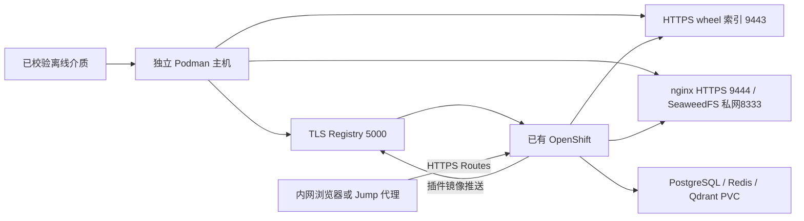

# Dify Enterprise 离线手工安装操作稿

本文供 Dify 同事按步骤手工重现安装，整理面向客户的手册。说明以当前客户 Ansible 实现为依据，操作命令在离线端直接使用 Podman、oc、Helm、jq/yq，不调用安装 Playbook。自动化主入口仍保持 Ansible，本篇没有新增另一个全流程脚本安装器。

操作范围：Dify Enterprise/Chart **3.9.8**、Linux amd64、RHEL 9 系、已有 OpenShift 4.20/4.21、namespace/release **dify**、单机 TLS Registry + wheel 索引 + 本地 SeaweedFS S3。已通过现场验证的是自动安装及修复后的验收；**本篇手工顺序仍需在空白目标完整执行验证**。命令和数据转换可做本地回归，不能据此声称手工现场安装已经通过。

本篇从**制作侧交付的可校验介质**开始；联网制作仍使用 [Quick Start 第 1～2 节](customer-quickstart.md)。这能让自动安装与手工安装使用同一批镜像、Chart及配置，手工复现离线安装不要求重新手工设计镜像清单。若将来单独编写纯手工制包手册，应另外验证其制品与此介质契约一致。

## 1. 先看清安装结构



Registry 保存平台镜像及插件构建镜像；wheel 索引保存插件 Python 依赖，不负责模型；SeaweedFS 保存对象数据。默认不安装 Git、ArgoCD、ODF、SSO、模型或观测平台。六个 Route 使用集群 Router 证书，**不是** Podman 服务的证书。内部 PostgreSQL/Redis 未启用 TLS，Qdrant 为集群内 HTTP；生产内部加密要求应单独适配。

三个 PostgreSQL/Redis/Qdrant PVC 默认是 **30/5/30 GiB**。预留镜像、容器层、Registry、S3及备份空间；建议 Podman 主机数据盘至少60 GiB并按实际使用扩容，不以压缩包大小计算运行空间。客户提供稳定内网 DNS、StorageClass、cluster-admin kubeconfig及网络通道：节点/Pod可访问主机5000/9443/9444，运维端可访问集群6443及Route443。

**只在空白验证目标初装。** 手工操作期间不并行运行本篇或自动安装入口；本篇不创建自动安装器的独占租约。 不对正在使用的在线 GitOps或自动离线安装执行本篇；同名namespace、容器、Helm release存在时停止，不接管或删除。客户端未安装的功能、License、插件和模型不因Pod Ready就自动可用。

## 2. 准备文件、工具和操作终端

### 2.1 制作侧交付什么

由联网制作机管理员交付：

1. `dify-offline-3.9.8-linux-amd64.tar.gz`及同名`.sha256`，来源为已成功完成的`customer-prepare.yml`。
2. **同一已审核版本的完整工程源码压缩包及其SHA256**。本篇使用其中`docs/manual-offline/map-images.jq`、`resolve-values.jq`、`s3-probe.sh`；它们随源码提供，不假定已存在于旧bundle里。
3. OS离线软件及完整依赖：Podman、openssl、httpd-tools、tar、coreutils、jq **1.6或以上**，另提供 **Mike Farah yq v4.44.3** 的Linux amd64可执行文件。这里的yq不是Python同名包。oc/Helm使用bundle内的版本；纯手工操作不要求Ansible/Python。

工具在联网侧从客户可信软件源获取；yq来源为[官方固定版本发布页](https://github.com/mikefarah/yq/releases/tag/v4.44.3)，先核对发布方校验材料，再为实际交付的二进制生成SHA256随可信渠道搬运。不要让离线端运行curl、包管理器联网下载、Helm repo update或podman pull。

源镜像认证、客户kubeconfig、服务私钥和License不进入公共介质。`controller-wheels`只用于Ansible控制端，不是插件依赖闭包。此处的“源码”用于获取公开过滤文件，不要求客户安装Git。

### 2.2 离线端设置路径

**以下第2～12节均在离线Podman主机，用Bash的root shell执行。** 另开终端时先恢复本节变量。路径输入绝对路径、不含空格；不要照抄RHDP目录。制作侧已将介质放到接收目录、完整源码解包到另一个目录；它们与私有状态目录分开。

```bash
# 遇到命令失败、未定义变量或管道中任一步失败即停止，避免带着错误继续安装。
set -euo pipefail
# 此终端新建的普通文件仅当前用户可读写，保护后续生成的凭证和私有清单。
umask 077
printf '介质tar.gz和sha256所在接收目录：'
read -r MEDIA
printf '已解包完整源码的根目录：'
read -r SOURCE
printf '本次手工安装的新私有工作目录（必须不存在）：'
read -r WORK
printf '客户kubeconfig绝对路径：'
read -r KUBECONFIG
export KUBECONFIG
printf '客户确认的context：'
read -r CTX
# 检查输入均为绝对路径；工作目录不能有空格、位于源码/介质内或经过符号链接。
[[ "$MEDIA" == /* && "$SOURCE" == /* && "$WORK" == /* && "$KUBECONFIG" == /* ]]
[[ "$WORK" != *[[:space:]]* && "$MEDIA" != *[[:space:]]* && "$SOURCE" != *[[:space:]]* ]]
[[ "$WORK" != "$MEDIA"/* && "$WORK" != "$SOURCE"/* ]]
test "$(realpath -m -- "$WORK")" = "$WORK"
# 只为本次初装创建新工作目录，避免覆盖已有状态。
test ! -e "$WORK"
install -d -m 0700 "$WORK"
# 切到介质接收目录，按随包提供的 SHA256 校验压缩包。
cd "$MEDIA"
sha256sum -c dify-offline-3.9.8-linux-amd64.tar.gz.sha256
# 确认没有旧解包目录，再解出 bundle；已有且校验过的 bundle 按正文说明跳过这两行。
test ! -e bundle
tar --no-same-owner -xzf dify-offline-3.9.8-linux-amd64.tar.gz
# 后续只读 BUNDLE；所有新配置、密钥和中间文件写入 WORK/STATE。
export BUNDLE="$MEDIA/bundle"
# 优先使用介质中已校验的 oc 和 Helm，不使用主机上可能版本不符的同名程序。
export PATH="$BUNDLE/bin:$PATH"
export STATE="$WORK/state"
install -d -m 0700 "$STATE"
# 确认完整源码已带上本文使用的数据过滤文件和 S3 探针。
test -f "$SOURCE/docs/manual-offline/map-images.jq"
# 确认完整源码已带上本文使用的数据过滤文件和 S3 探针。
test -f "$SOURCE/docs/manual-offline/resolve-values.jq"
# 确认完整源码已带上本文使用的数据过滤文件和 S3 探针。
test -f "$SOURCE/docs/manual-offline/s3-probe.sh"
# 核对工具版本：jq 1.6+、Mike Farah yq 4.44.3、包内 Helm 和主机 Podman。
jq --version
yq --version
helm version --short
podman --version
```

如果接收目录已经解包并校验成功，只跳过`test ! -e bundle`和解包命令，继续设置BUNDLE；不要在已有bundle上覆盖解包。WORK必须是专用真实路径，不位于源码、bundle或Git目录内，也不通过symlink指向这些目录。所有步骤失败后先停下，不跳过校验继续执行。

### 2.3 校验完整文件集合

外层SHA通过后，继续验证包内文件集合及内容；不能直接`sha256sum -c checksums.json`，它是JSON文件。下面限制文件名为本工程受控字符，拒绝路径穿越、额外文件和链接，任何不支持的文件名需重新审查交付包，不通过重写清单绕过。

```bash
# 先验证清单中的路径格式；-e 使条件不满足时返回失败。
jq -e 'all(keys[]; test("^[A-Za-z0-9_./+-]+$") and
  (startswith("/")|not) and (split("/")|index("..")|not))' \
  "$BUNDLE/checksums.json" >/dev/null
# 拒绝符号链接和特殊文件；这里只允许目录和普通文件。
test -z "$(find "$BUNDLE" ! -type f ! -type d -print -quit)"
# 生成清单期望的文件名集合；checksums.json 本身不在其自校验范围，单独加入。
jq -r 'keys + ["checksums.json"] | sort[]' "$BUNDLE/checksums.json" > "$WORK/expected-files"
# 生成实际文件名集合，随后用 diff 拒绝多余或缺失文件。
find "$BUNDLE" -type f -printf '%P\n' | LC_ALL=C sort > "$WORK/actual-files"
diff -u "$WORK/expected-files" "$WORK/actual-files"
# 将 JSON 摘要表转换成 sha256sum 可读取的格式，再逐文件核对内容。
jq -r 'to_entries[] | "\(.value)  \(.key)"' "$BUNDLE/checksums.json" > "$WORK/files.sha256"
(cd "$BUNDLE" && sha256sum -c "$WORK/files.sha256")
# 将公开 YAML 配置和镜像锁转成 JSON，供后续 jq 读取；不修改包内文件。
yq -o=json '.' "$BUNDLE/config.yaml" > "$WORK/config.json"
yq -o=json '.' "$BUNDLE/images.lock.yaml" > "$WORK/lock.json"
jq -e '.format == 1 and .status == "exported" and .platform == "linux/amd64" and (.images|length)>0' \
  "$WORK/lock.json" >/dev/null
```

所有输出必须通过。后续文件只写WORK，不改bundle。`images.lock.yaml`中`source`是引用、`archive`是归档相对路径、`imageId`是OCI config身份；源Docker ID可能因转OCI变化，不能拿`sourceImageId`替代加载ID。

## 3. 核对现场配置和空白目标

配置已经在制作时写入`config.yaml`，离线端读出，不重新输入一套不同的域名。

```bash
# 从制包时固化的配置读出服务地址，不能在离线端另填一套与包不符的值。
REGISTRY=$(jq -r '.offline.registry' "$WORK/config.json")
HOST=${REGISTRY%:*}
REGISTRY_PORT=${REGISTRY##*:}
PIP_URL=$(jq -r '.offline.pipMirror' "$WORK/config.json")
S3_PORT=$(jq -r '.offline.localS3.port' "$WORK/config.json")
BUCKET=$(jq -r '.offline.localS3.bucket' "$WORK/config.json")
APPS=$(jq -r '.deployer.domain' "$WORK/config.json")
LOCK_SHA=$(sha256sum "$BUNDLE/images.lock.yaml" | awk '{print $1}')
export HOST REGISTRY REGISTRY_PORT PIP_URL S3_PORT BUCKET APPS LOCK_SHA
# 本操作稿只覆盖 dify、amd64、本地 S3 及默认端口；扩展配置在这里明确拒绝。
jq -e '.namespace == "dify" and .offline.platform == "linux/amd64" and
  .offline.localS3.enabled == true and .offline.localS3.port == 9444 and
  (.offline.pipMirror | endswith(":9443/simple/")) and
  .components.objectStorage.enabled == false and .components.minio.enabled == false' \
  "$WORK/config.json" >/dev/null
test "$REGISTRY_PORT" = 5000
test "$PIP_URL" = "https://$HOST:9443/simple/"
# 读取目标集群版本和应用域名，保存到私有工作目录作后续比较。
oc --context "$CTX" get clusterversion version -o json > "$WORK/cluster.json"
oc --context "$CTX" get ingress.config.openshift.io cluster -o json > "$WORK/ingress.json"
# 比较实际 ingress 域与介质域，避免把同一包安装到错误环境。
jq -e --arg apps "$APPS" '.spec.domain == $apps' "$WORK/ingress.json" >/dev/null
jq -e '.status.desired.version | test("^4\\.(20|21)\\.")' "$WORK/cluster.json" >/dev/null
# 查看节点状态；下面还用 JSON 明确校验 amd64 和 Ready。
oc --context "$CTX" get nodes -o wide
oc --context "$CTX" get nodes -o json > "$WORK/nodes.json"
jq -e '(.items|length)>0 and all(.items[];
  .status.nodeInfo.architecture=="amd64" and any(.status.conditions[]; .type=="Ready" and .status=="True"))' \
  "$WORK/nodes.json" >/dev/null
oc --context "$CTX" get clusteroperators
oc --context "$CTX" get storageclass
# 分别读取三个组件选择的 StorageClass，确认客户集群实际存在。
for component in postgresql redis qdrant; do
  storage_class=$(jq -er --arg c "$component" '.components[$c].storage.storageClassName | select(length>0)' "$WORK/config.json")
  oc --context "$CTX" get storageclass "$storage_class"
done
# 初装要求 namespace 不存在；发现已有安装时停止，不自动接管。
oc --context "$CTX" get ns dify --ignore-not-found -o name > "$WORK/existing-namespace"
test ! -s "$WORK/existing-namespace"
# 同样检查三个本地容器名未被使用，避免覆盖另一套服务。
for name in dify-offline-s3 dify-offline-registry dify-offline-pypi; do
  if podman --cgroup-manager=cgroupfs container exists "$name"; then
    printf '同名容器已存在，停止：%s\n' "$name"
    exit 1
  fi
done
# 确认 Podman 服务主机名可以从当前主机解析；节点/Pod连通性还需后续验证。
getent ahostsv4 "$HOST"
```

节点必须Ready、版本/架构匹配，全部ClusterOperator健康；存储类实际存在。此稿固定5000/9443/9444，其他端口先同步nginx、映射和验证命令后另测。公共values-disconnected.yaml不是最终配置：客户Role还覆盖了对象存储开关、主机、端口、SC，手工应以bundle/config.yaml为准。

## 4. 生成稳定凭证和TLS

只在初装生成，不能为“重跑”重新生成另一套。目录权限0700，文件由umask077创建。以下自建CA适用于允许实验私有PKI的现场，有效期365天；客户正式PKI应提供相同路径的server.crt/server.key/ca.crt，SAN覆盖HOST，并跳过生成步骤。

```bash
# 创建私有持久化目录；证书、认证、Registry 和 S3 数据分别保存。
install -d -m 0700 "$STATE/certificates" "$STATE/tls" "$STATE/auth" \
  "$STATE/registry-data" "$STATE/s3-data" "$STATE/podman-certs" "$WORK/keys"
# 生成本地 CA 证书和私钥；客户提供正式 PKI 时按正文跳过这些生成步骤。
openssl req -x509 -newkey rsa:3072 -nodes -days 365 \
  -keyout "$STATE/certificates/ca.key" -out "$STATE/certificates/ca.crt" \
  -subj '/CN=Dify Offline CA' -addext 'basicConstraints=critical,CA:TRUE'
# 生成服务私钥和 CSR，CN 使用配置中的真实 Podman 主机名。
openssl req -new -newkey rsa:3072 -nodes \
  -keyout "$STATE/certificates/server.key" -out "$STATE/certificates/server.csr" -subj "/CN=$HOST"
# 写入 SAN、非 CA 及 serverAuth 约束，供下一条签发叶子证书。
printf 'subjectAltName=DNS:%s\nbasicConstraints=critical,CA:FALSE\nextendedKeyUsage=serverAuth\n' \
  "$HOST" > "$STATE/certificates/server.ext"
# 使用本地 CA 签发服务证书，有效期 365 天。
openssl x509 -req -days 365 -in "$STATE/certificates/server.csr" \
  -CA "$STATE/certificates/ca.crt" -CAkey "$STATE/certificates/ca.key" -CAcreateserial \
  -extfile "$STATE/certificates/server.ext" -out "$STATE/certificates/server.crt"
# 验证证书链及主机名；失败时不要继续启动服务。
openssl verify -CAfile "$STATE/certificates/ca.crt" -verify_hostname "$HOST" "$STATE/certificates/server.crt"
# 为容器准备证书挂载目录；Podman 客户端的 CA 单独复制到 podman-certs。
cp "$STATE/certificates/server.crt" "$STATE/tls/server.crt"
cp "$STATE/certificates/server.key" "$STATE/tls/server.key"
cp "$STATE/certificates/ca.crt" "$STATE/podman-certs/ca.crt"
# 生成 Registry 密码到私有文件，不把密码放进命令参数。
openssl rand -hex 32 > "$WORK/keys/registry-password"
# 通过标准输入生成 offline 用户的 bcrypt 校验值，供 Registry 验证登录。
htpasswd -niB offline < "$WORK/keys/registry-password" > "$STATE/htpasswd"
cp "$STATE/htpasswd" "$STATE/auth/htpasswd"
# 生成目标 Registry auth.json：键为主机:端口，auth 为 offline:密码的 base64。
jq -n --arg registry "$REGISTRY" --rawfile password "$WORK/keys/registry-password" \
  '{auths:{($registry):{auth:(("offline:"+($password|rtrimstr("\n")))|@base64)}}}' > "$STATE/auth.json"
# 生成 S3 身份；下面保存 JSON 和容器 env 文件，集群 Secret 复用同一组值。
openssl rand -hex 12 > "$WORK/keys/s3-access"
openssl rand -hex 32 > "$WORK/keys/s3-secret"
jq -n --arg bucket "$BUCKET" --rawfile access "$WORK/keys/s3-access" --rawfile secret "$WORK/keys/s3-secret" \
  '($access|rtrimstr("\n")) as $a | ($secret|rtrimstr("\n")) as $s | {bucket:$bucket,accessKey:("dify"+$a),secretKey:$s}' \
  > "$STATE/local-s3.json"
# 把 S3 JSON 转成 SeaweedFS 容器所需的三行环境变量文件。
jq -r '["AWS_ACCESS_KEY_ID=" + .accessKey, "AWS_SECRET_ACCESS_KEY=" + .secretKey, "S3_BUCKET=" + .bucket] | join("\n")' \
  "$STATE/local-s3.json" > "$STATE/local-s3.env"
# 收紧证书和凭证文件权限，不向终端打印内容。
chmod 0600 "$STATE"/*.json "$STATE"/*.env "$STATE/htpasswd" "$STATE"/certificates/* "$STATE"/tls/* "$STATE"/auth/*
```

认证只写入私有文件；不能输出auth.json给同事看，也不能将源拉取authfile当作本地Registry凭证。上面的密码不出现在argv中。`local-s3.json`之后会原样转成集群S3 Secret。

## 5. 手工加载服务镜像并启动三个容器

先验证和加载roles标记的服务镜像。后面第6节还会遍历全部镜像导入Registry，不假定服务镜像在某个固定编号。

```bash
# 按 lock 中 roles 选择基础服务镜像，只从本地 OCI 归档加载。
jq -r '.images[] | select((.roles|length)>0) | .archive' "$WORK/lock.json" |
while IFS= read -r archive; do
  # 校验通过后加载归档；普通镜像直接推送，构建基础镜像先加入私有 CA。
  podman --cgroup-manager=cgroupfs load -i "$BUNDLE/$archive"
done
# 读取可加载的 OCI imageId，不能用源 Docker ID 或凭镜像编号猜角色。
REGISTRY_ID=$(jq -r '.images[] | select(.roles|index("registry")) | .imageId' "$WORK/lock.json")
NGINX_ID=$(jq -r '.images[] | select(.roles|index("wheel-server")) | .imageId' "$WORK/lock.json")
S3_ID=$(jq -r '.images[] | select(.roles|index("object-store")) | .imageId' "$WORK/lock.json")
test -n "$REGISTRY_ID" && test -n "$NGINX_ID" && test -n "$S3_ID"
# 写入 nginx 配置：9443 提供 wheel 索引，9444 把认证 S3 请求转发到私网服务。
cat > "$STATE/nginx.conf" <<'NGINX'
events {}
http {
  server {
    listen 9443 ssl;
    ssl_certificate /certs/server.crt;
    ssl_certificate_key /certs/server.key;
    root /usr/share/nginx/html;
    location /simple/ { autoindex off; }
  }
  server {
    listen 9444 ssl;
    ssl_certificate /certs/server.crt;
    ssl_certificate_key /certs/server.key;
    client_max_body_size 0;
    location / {
      proxy_pass http://dify-offline-s3:8333;
      proxy_set_header Host $http_host;
      proxy_request_buffering off;
      proxy_buffering off;
    }
  }
}
NGINX
# 创建专用容器网络；SeaweedFS 的 8333 端口不发布到主机。
podman --cgroup-manager=cgroupfs network create dify-offline
# 创建 S3 容器：禁止拉取、使用私有 env、持久化 /data，仅接入专用网络。
podman --cgroup-manager=cgroupfs create --name dify-offline-s3 --pull=never \
  --restart=unless-stopped --label "io.dify.offline.bundle=$LOCK_SHA" \
  --network dify-offline --user 0 --env-file "$STATE/local-s3.env" \
  -v "$STATE/s3-data:/data:Z" "$S3_ID" mini -dir=/data
# 创建 TLS Registry：发布 5000，并挂载持久化数据、共用证书及 htpasswd。
podman --cgroup-manager=cgroupfs create --name dify-offline-registry --pull=never \
  --restart=unless-stopped --label "io.dify.offline.bundle=$LOCK_SHA" -p 5000:5000 \
  -v "$STATE/registry-data:/var/lib/registry:Z" -v "$STATE/tls:/certs:ro,z" -v "$STATE/auth:/auth:ro,Z" \
  -e REGISTRY_HTTP_TLS_CERTIFICATE=/certs/server.crt -e REGISTRY_HTTP_TLS_KEY=/certs/server.key \
  -e REGISTRY_AUTH=htpasswd -e REGISTRY_AUTH_HTPASSWD_REALM=offline \
  -e REGISTRY_AUTH_HTPASSWD_PATH=/auth/htpasswd "$REGISTRY_ID"
# 创建 nginx：只读挂载索引/配置，发布 9443 和 9444，证书目录使用共享 SELinux 标签。
podman --cgroup-manager=cgroupfs create --name dify-offline-pypi --pull=never \
  --restart=unless-stopped --label "io.dify.offline.bundle=$LOCK_SHA" --network dify-offline \
  -p 9443:9443 -p 9444:9444 -v "$BUNDLE/pypi:/usr/share/nginx/html:ro,Z" \
  -v "$STATE/tls:/certs:ro,z" -v "$STATE/nginx.conf:/etc/nginx/nginx.conf:ro,Z" "$NGINX_ID"
# 按 S3 → Registry → nginx 顺序启动，再查看容器状态。
podman --cgroup-manager=cgroupfs start dify-offline-s3 dify-offline-registry dify-offline-pypi
podman --cgroup-manager=cgroupfs ps
# 将 Basic 认证头写入私有文件，curl 读取该文件，避免密码出现在 argv。
jq -r --arg registry "$REGISTRY" '.auths[$registry].auth | "Authorization: Basic "+.' \
  "$STATE/auth.json" > "$WORK/registry-header"
# 验证 Registry 认证与 TLS；下一项验证 wheel 索引，最后一项应返回匿名 S3 的 403。
curl --noproxy '*' --cacert "$STATE/certificates/ca.crt" --header "@$WORK/registry-header" \
  --fail --retry 10 --retry-connrefused "https://$REGISTRY/v2/"
curl --noproxy '*' --cacert "$STATE/certificates/ca.crt" --fail "https://$HOST:9443/simple/"
curl --noproxy '*' --cacert "$STATE/certificates/ca.crt" -sS -o /dev/null -w 'HTTP %{http_code}\n' "https://$HOST:9444/"
```

前两项应成功，匿名S3根路径应为403；403仅证明匿名被拒绝。S3原始8333/Admin端口不对外发布。TLS目录被两个容器共享，用`:z`，不随意改成独占`:Z`。wheel索引无账号认证，客户应限制内网访问范围。若服务启动慢可重做本节最后的检查，不重复create。

## 6. 将所有镜像导入本地Registry

目标仓库使用lock原始顺序的三位索引。每个归档先校验OCI manifest/config，加载后检查架构。Python构建基础镜像及Kaniko在本机加入CA，构建禁止pull和网络；最终记录的是push得到的**目标manifest digest**，不是源Docker ID或源manifest。

```bash
# 初始化目标镜像映射；必须等本节全部导入成功才能用于部署。
printf '{}\n' > "$STATE/image-map.json"
COUNT=$(jq '.images|length' "$WORK/lock.json")
# 按 lock 原始索引逐张导入；三位编号由此索引生成，不重新排序。
for ((i=0; i<COUNT; i++)); do
  source=$(jq -r --argjson i "$i" '.images[$i].source' "$WORK/lock.json")
  archive=$(jq -r --argjson i "$i" '.images[$i].archive' "$WORK/lock.json")
  image_id=$(jq -r --argjson i "$i" '.images[$i].imageId' "$WORK/lock.json")
  source_digest=$(jq -r --argjson i "$i" '.images[$i].sourceDigest' "$WORK/lock.json")
  # 读取 OCI 索引，验证只有一个 manifest，再逐级验证 manifest/config 摘要和架构。
  tar -xOf "$BUNDLE/$archive" index.json > "$WORK/oci-index.json"
  jq -e '.manifests|length==1' "$WORK/oci-index.json" >/dev/null
  digest=$(jq -r '.manifests[0].digest' "$WORK/oci-index.json")
  test "$digest" = "$source_digest"
  tar -xOf "$BUNDLE/$archive" "blobs/sha256/${digest#sha256:}" > "$WORK/oci-manifest.json"
  test "sha256:$(sha256sum "$WORK/oci-manifest.json" | awk '{print $1}')" = "$digest"
  config_digest=$(jq -r '.config.digest' "$WORK/oci-manifest.json")
  test "$config_digest" = "$image_id"
  tar -xOf "$BUNDLE/$archive" "blobs/sha256/${config_digest#sha256:}" > "$WORK/oci-config.json"
  test "sha256:$(sha256sum "$WORK/oci-config.json" | awk '{print $1}')" = "$image_id"
  jq -e '.os=="linux" and .architecture=="amd64"' "$WORK/oci-config.json" >/dev/null
  # 校验通过后加载归档；普通镜像直接推送，构建基础镜像先加入私有 CA。
  podman --cgroup-manager=cgroupfs load -i "$BUNDLE/$archive"
  push_id=$image_id
  # 只对 Kaniko 和 Python 构建基础镜像派生 CA 镜像，处理动态插件构建时的 TLS 信任。
  if [[ "$source" == *kaniko-project/executor* || "$source" == */plugin-build-base-python:* ]]; then
    builddir=$(mktemp -d "$STATE/ca-build.XXXXXX")
    cp "$STATE/certificates/ca.crt" "$builddir/ca.crt"
    podman --cgroup-manager=cgroupfs tag "$image_id" "localhost/dify-offline-base:$i"
    printf 'FROM localhost/dify-offline-base:%s\n' "$i" > "$builddir/Containerfile"
    if [[ "$source" == *kaniko-project/executor* ]]; then
      printf 'COPY ca.crt /kaniko/ssl/certs/offline-registry.crt\nENV SSL_CERT_DIR=/kaniko/ssl/certs\n' >> "$builddir/Containerfile"
    else
      printf 'COPY ca.crt /opt/offline-ca.crt\nENV SSL_CERT_FILE=/opt/offline-ca.crt REQUESTS_CA_BUNDLE=/opt/offline-ca.crt PIP_CERT=/opt/offline-ca.crt UV_NATIVE_TLS=true\n' >> "$builddir/Containerfile"
    fi
    # 构建时禁止拉取和网络，保存派生 image ID；临时构建目录用完即删除。
    podman --cgroup-manager=cgroupfs build --pull=never --network=none --iidfile "$builddir/image-id" "$builddir"
    push_id=$(cat "$builddir/image-id")
    rm -r -- "$builddir"
  fi
  # 生成本条镜像在本地 Registry 的稳定编号仓库。
  printf -v repository '%s/dify-offline/image-%03d' "$REGISTRY" "$i"
  # 通过私有 CA 和目标 authfile 推送，将实际目标 manifest digest 写入文件。
  podman --cgroup-manager=cgroupfs push --authfile "$STATE/auth.json" --cert-dir "$STATE/podman-certs" \
    --digestfile "$STATE/push-digest" "$push_id" "docker://$repository:bundle"
  target_digest=$(cat "$STATE/push-digest")
  [[ "$target_digest" =~ ^sha256:[a-f0-9]{64}$ ]]
  # 把源引用映射到目标仓库@digest，写临时文件后原子替换映射表。
  jq --arg source "$source" --arg target "$repository@$target_digest" '. + {($source):$target}' \
    "$STATE/image-map.json" > "$STATE/image-map.json.next"
  mv "$STATE/image-map.json.next" "$STATE/image-map.json"
  printf '已导入 %s/%s：%s\n' "$((i+1))" "$COUNT" "$source"
done
test "$(jq 'length' "$STATE/image-map.json")" = "$COUNT"
```

此循环只处理本节的load/build/push和映射，出错即停；保留已有Registry数据。导入未完成时不能进入部署。若重做本节，所有镜像重新验证/push，临时映射重新生成，不重新生成CA或密码。

## 7. 配置节点CA、namespace和Secret

### 7.1 合并节点信任

不能覆盖客户已有CA ConfigMap。先读引用名，存在则merge一个键，不存在引用才创建专用ConfigMap；image config更新带resourceVersion检查。端口在ConfigMap键中写作`..5000`，不是`:5000`。

```bash
# 先读取集群正在使用的信任 ConfigMap 引用及 resourceVersion，保留客户已有配置。
oc --context "$CTX" get image.config.openshift.io cluster -o json > "$WORK/image-config.json"
TRUST_CM=$(jq -r '.spec.additionalTrustedCA.name // ""' "$WORK/image-config.json")
if [[ -z "$TRUST_CM" ]]; then TRUST_CM=dify-offline-registry-cas; fi
oc --context "$CTX" -n openshift-config get cm "$TRUST_CM" --ignore-not-found -o json > "$WORK/trust-existing.json"
# CA ConfigMap 的键将端口分隔符 : 转为 ..；patch 只增加本 Registry 的键。
jq -n --arg key "${REGISTRY//:/..}" --rawfile ca "$STATE/certificates/ca.crt" \
  '{data:{($key):$ca}}' > "$WORK/ca-patch.json"
# 已有 ConfigMap 就合并一个键；没有才创建，不清空客户其他 CA。
if [[ -s "$WORK/trust-existing.json" ]]; then
  oc --context "$CTX" -n openshift-config patch cm "$TRUST_CM" --type=merge --patch-file "$WORK/ca-patch.json"
else
  oc --context "$CTX" -n openshift-config create configmap "$TRUST_CM" \
    --from-file="${REGISTRY//:/..}=$STATE/certificates/ca.crt"
fi
# 构造带 resourceVersion 前置校验的 JSON Patch，避免静默覆盖并发配置变更。
jq --arg name "$TRUST_CM" '[
  {op:"test",path:"/metadata/resourceVersion",value:.metadata.resourceVersion},
  {op:"add",path:"/spec/additionalTrustedCA",value:{name:$name}}]' \
  "$WORK/image-config.json" > "$WORK/image-patch.json"
oc --context "$CTX" patch image.config.openshift.io cluster --type=json --patch-file "$WORK/image-patch.json"
oc --context "$CTX" get machineconfigpools
# 信任配置提交后创建本次应用 namespace。
oc --context "$CTX" create namespace dify
```

等待节点配置收敛并通过实际拉取检查，不能只看ConfigMap成功。这里需要集群管理员权限。仅有namespace admin不足以安装本篇的CA、CRD、SCC。

### 7.2 创建目标认证与稳定应用密钥

下面的create操作用于新namespace；已有同名Secret时先停止核对，不用覆盖或随机轮换来“修复”。

```bash
# 创建镜像拉取凭证；只传入私有文件路径，不在命令行提供真实密码。
oc --context "$CTX" -n dify create secret generic offline-registry-pull \
  --type=kubernetes.io/dockerconfigjson --from-file=.dockerconfigjson="$STATE/auth.json"
# 插件构建推送凭证必须包含 .dockerconfigjson 和 config.json 两个键。
oc --context "$CTX" -n dify create secret generic image-repo-secret \
  --type=kubernetes.io/dockerconfigjson --from-file=.dockerconfigjson="$STATE/auth.json" --from-file=config.json="$STATE/auth.json"
# 应用/探针使用服务 CA；它不替代节点拉取信任或浏览器 Route CA。
oc --context "$CTX" -n dify create secret generic offline-registry-ca --from-file=ca.crt="$STATE/certificates/ca.crt"
# 首次生成三项稳定应用密钥，写无末尾换行的私有文件。
for key in appSecretKey innerApiKey dashboardSecretKey; do
  openssl rand -hex 28 | tr -d '\n' > "$WORK/keys/$key"
done
# 从文件创建应用密钥 Secret，后续 values 按键引用它们。
oc --context "$CTX" -n dify create secret generic dify-offline-keys \
  --from-file=appSecretKey="$WORK/keys/appSecretKey" --from-file=innerApiKey="$WORK/keys/innerApiKey" \
  --from-file=dashboardSecretKey="$WORK/keys/dashboardSecretKey"
# S3 Secret 复用主机已创建的身份；-j 不在值后追加换行。
jq -j '.accessKey' "$STATE/local-s3.json" > "$WORK/keys/s3-access-value"
jq -j '.secretKey' "$STATE/local-s3.json" > "$WORK/keys/s3-secret-value"
oc --context "$CTX" -n dify create secret generic dify-local-s3 \
  --from-file=accessKey="$WORK/keys/s3-access-value" --from-file=secretKey="$WORK/keys/s3-secret-value"
```

`image-repo-secret`需要两个键，不能只创建`.dockerconfigjson`。三组应用密钥稳定保存，不能在有业务数据后重新生成。S3 Secret必须与主机相同，否则服务虽然启动，应用也无法访问对象。

## 8. 生成并安装依赖资源

子Chart读取顶层`postgresql/redis/...`，而bundle配置将它们放在`components`下，不能直接`-f config.yaml`。以下逐组生成values、渲染、转换，再apply；处理文件全部在WORK。

```bash
# 创建依赖资源的私有输出目录，使用包内本地子 Chart。
install -d -m 0700 "$WORK/dependencies"
COMPONENTS="$BUNDLE/source/examples/helm/components"
# 按前置权限/凭证 → CRD → PostgreSQL → Redis → Qdrant 的顺序逐组安装。
for pair in prereqs:dify-prereqs pluginCrds:plugin-crds postgresql:postgresql redis:redis qdrant:qdrant; do
  field=${pair%%:*}
  chart=${pair#*:}
  # CRD Chart 的输入形状与其他子 Chart 不同，单独生成其 values。
  if [[ "$field" == pluginCrds ]]; then
    printf '{"plugin_controller":{"installCrd":true}}\n' > "$WORK/dependencies/$chart-values.json"
  else
    # 把 components 下的组件配置提升到子 Chart 所需顶层，并关闭在线构建/集成。
    jq --arg field "$field" '
      {($field):(.components[$field] + {namespace:"dify",serviceAccountName:.components.prereqs.serviceAccountName})}
      | if $field == "prereqs" then .prereqs *= {
          minioCredentials:false,userAccess:{enabled:false},imageRepoSecret:{enabled:false},
          imageBuilder:{enabled:false},monitoring:{enabled:false,dashboard:{enabled:false},alerts:{enabled:false}}}
        else . end' "$WORK/config.json" > "$WORK/dependencies/$chart-values.json"
  fi
  # 仅本地渲染，不下载 Chart；显式声明 OpenShift API 能力。
  helm template dify "$COMPONENTS/$chart" -n dify -f "$WORK/dependencies/$chart-values.json" \
    --api-versions route.openshift.io/v1 --api-versions security.openshift.io/v1 > "$WORK/dependencies/$chart-raw.yaml"
  # 把多文档 YAML 转成 JSON 流，过滤空文档，映射镜像/认证，再组成可 apply 的 List。
  yq -o=json '.' "$WORK/dependencies/$chart-raw.yaml" |
    jq 'select(type=="object")' |
    jq --slurpfile image_map "$STATE/image-map.json" -f "$SOURCE/docs/manual-offline/map-images.jq" |
    jq -s '{apiVersion:"v1",kind:"List",items:.}' > "$WORK/dependencies/$chart.json"
  # 先 apply SA/RBAC 等普通资源，再创建凭证 Job，避免 Job 先于权限。
  jq '.items |= map(select(.kind!="Job"))' "$WORK/dependencies/$chart.json" > "$WORK/dependencies/$chart-main.json"
  oc --context "$CTX" apply -f "$WORK/dependencies/$chart-main.json"
  # 每组等待其实际依赖就绪：凭证 Job、CRD Established 或 StatefulSet rollout。
  if [[ "$chart" == dify-prereqs ]]; then
    jq '.items |= map(select(.kind=="Job"))' "$WORK/dependencies/$chart.json" > "$WORK/dependencies/$chart-jobs.json"
    oc --context "$CTX" apply -f "$WORK/dependencies/$chart-jobs.json"
    oc --context "$CTX" -n dify wait job/dify-generate-secrets --for=condition=complete --timeout=600s
  elif [[ "$chart" == plugin-crds ]]; then
    oc --context "$CTX" wait crd/difyplugins.enterprise.dify.ai --for=condition=Established --timeout=120s
  else
    oc --context "$CTX" -n dify rollout status "statefulset/dify-$chart" --timeout=600s
  fi
done
oc --context "$CTX" -n dify get pvc
```

prereqs先建SA/RBAC再执行凭证Job，Job生成`dify-postgresql`（database/username/password）、`dify-redis`（password）、`dify-qdrant`（apiKey）。PostgreSQL启动脚本确保四个库`dify/enterprise/audit/dify_plugin_daemon`存在，不能依赖旧注释所说的“插件库自动创建”。PG fsGroup=26、Redis fsGroup=1001不能随意删除。PVC默认30/5/30Gi，SC以配置为准；WaitForFirstConsumer允许Pod调度后绑定。

权限包含anyuid基线、自定义sandbox SCC（SYS_CHROOT等，非privileged容器）、plugin connector的nonroot SCC，以及插件CRD/RBAC。不能为解决Pending而将namespace全体改为privileged。vendor Chart自己的权限还需在第10节一并检查。

## 9. 生成真正的离线vendor values

先渲染本地Dify child，只取它生成的values数据，不apply其在线Application或ConfigMap。然后叠加vendor defaults、本地TLS/S3/Registry和稳定密钥。

```bash
# 生成 Dify child 的顶层输入；关闭其在线 Chart Application，仅提取 values 数据。
jq '{dify:(.components.dify + {namespace:"dify",serviceAccountName:.components.prereqs.serviceAccountName,chart:{enabled:false}}),
  deployer:.deployer,litemaas:{apiUrl:"",apiKey:"",model:""},objectStorage:.components.objectStorage}' \
  "$WORK/config.json" > "$WORK/dify-child-values.json"
# 本地渲染 Dify child，结果只用于提取 dify-values，不直接 apply。
helm template dify "$COMPONENTS/dify" -n dify -f "$WORK/dify-child-values.json" \
  --api-versions route.openshift.io/v1 --api-versions security.openshift.io/v1 > "$WORK/dify-child.yaml"
# 从多文档结果中准确取出 dify-values ConfigMap 的 YAML 文本。
yq -o=json '.' "$WORK/dify-child.yaml" | jq -s -r \
  '[.[] | select(.kind=="ConfigMap" and .metadata.name=="dify-values")][0].data["dify-values.yaml"]' \
  > "$WORK/vendor-base.yaml"
# 读取包内 vendor Chart 默认配置，包括运行时镜像和生成器配置。
helm show values "$BUNDLE/dify-enterprise.tgz" > "$WORK/vendor-defaults.yaml"
yq -o=json '.' "$WORK/vendor-defaults.yaml" > "$WORK/vendor-defaults.json"
yq -o=json '.' "$WORK/vendor-base.yaml" > "$WORK/vendor-base.json"
# generatorConf 本身是一段 YAML 字符串，先解析再修改其 pipMirror。
jq -r '.plugin_connector.generatorConf' "$WORK/vendor-defaults.json" | yq -o=json '.' > "$WORK/generator.json"
jq --arg mirror "$PIP_URL" '.generator.python.pipMirror=$mirror' "$WORK/generator.json" | yq -P '.' > "$WORK/generator.yaml"
# 递归合并 vendor defaults 和本地 child values，后者覆盖前者。
jq -s '.[0] * .[1]' "$WORK/vendor-defaults.json" "$WORK/vendor-base.json" > "$WORK/vendor-merged.json"
# 叠加本地 S3/TLS/Registry、稳定密钥引用及客户审核过的 chartValues。
jq --arg registry "$REGISTRY" --arg endpoint "https://$HOST:$S3_PORT" --arg bucket "$BUCKET" \
  --rawfile generator "$WORK/generator.yaml" --slurpfile cfg "$WORK/config.json" '
  . * {global:{appSecretKey:"@@secret:dify-offline-keys/appSecretKey@@",innerApiKey:"@@secret:dify-offline-keys/innerApiKey@@",
      customCA:{enabled:true,existingSecret:"offline-registry-ca"}},
    enterprise:{appSecretKey:"@@secret:dify-offline-keys/dashboardSecretKey@@"},imagePullSecrets:[{name:"offline-registry-pull"}],
    plugin_connector:{imageRepoPrefix:($registry+"/plugins"),imageRepoType:"docker",insecureImageRepo:false,generatorConf:$generator},
    persistence:{type:"s3",s3:{endpoint:$endpoint,accessKey:"@@secret:dify-local-s3/accessKey@@",
      secretKey:"@@secret:dify-local-s3/secretKey@@",bucketName:$bucket,region:"us-east-1",addressType:"",useAwsManagedIam:false,useAwsS3:false}}}
  * ($cfg[0].offline.chartValues // {})' "$WORK/vendor-merged.json" > "$WORK/vendor-offline.json"
# 拒绝 Marketplace/Ingress 等在线假设被重新打开，确认 OpenShift 模式。
jq -e '.global.marketplace.enabled==false and .ingress.enabled==false and .global.openshift.enabled==true' \
  "$WORK/vendor-offline.json" >/dev/null
# 读取 namespace 内 Secret 到私有文件，数据过滤器只解析显式引用，不打印凭证。
oc --context "$CTX" -n dify get secrets -o json > "$WORK/secrets.json"
# 先解析秘密，再在 Helm 计算 checksum 前映射运行时镜像；输出私有 JSON values。
jq --slurpfile secrets "$WORK/secrets.json" -f "$SOURCE/docs/manual-offline/resolve-values.jq" \
  "$WORK/vendor-offline.json" |
  jq --slurpfile image_map "$STATE/image-map.json" -f "$SOURCE/docs/manual-offline/map-images.jq" > "$WORK/vendor-values.json"
chmod 0600 "$WORK"/*.json "$WORK"/*.yaml
```

`@@secret:name/key@@`不是Helm能识别的语法。过滤文件从已读取的Secret JSON解析对应字段，不在shell中插入密码，也不使用未经转义的sed替换。values JSON本身是Helm支持的YAML输入，密码中的引号和换行会被正确编码。

这里先映射generatorConf、shader/gateway/busyBox/awsCli等运行时引用，再渲染vendor Chart，让生成Secret的checksum与内容匹配。仅修改Deployment image会漏掉动态创建的插件Pod。

## 10. 生成派生Chart并手工安装

渲染后处理：完整镜像引用替换、Secret中可解码文本的映射、所有Pod模板/SA拉取Secret，以及plugin-daemon OTLP HTTP端口修正。二进制Secret保持不变。不能直接对整个渲染结果`oc apply`代替Helm hooks，也不能将包含`{{...}}`的配置文本重新作为Helm表达式求值。

```bash
# 使用完整离线 values 渲染 vendor 资源，保留 hooks；仍不连接集群。
helm template dify "$BUNDLE/dify-enterprise.tgz" -n dify -f "$WORK/vendor-values.json" \
  --api-versions route.openshift.io/v1 --api-versions security.openshift.io/v1 > "$WORK/vendor-raw.yaml"
# 再次检查渲染后的可见/编码镜像引用，并为各种 Pod 模板补齐拉取 Secret。
yq -o=json '.' "$WORK/vendor-raw.yaml" | jq 'select(type=="object")' |
  jq --slurpfile image_map "$STATE/image-map.json" -f "$SOURCE/docs/manual-offline/map-images.jq" |
  jq -s '.' > "$WORK/vendor-resources.json"
# 派生 Chart 位于私有工作目录，包含真实敏感资源，不写回 bundle。
CHART="$WORK/offline-chart"
install -d -m 0700 "$CHART/templates"
# 保留原 Chart 身份，移除在线依赖声明；派生模板均已本地生成。
helm show chart "$BUNDLE/dify-enterprise.tgz" | yq -o=json '.' | jq 'del(.dependencies)' > "$CHART/Chart.yaml"
N=$(jq 'length' "$WORK/vendor-resources.json")
# 每个资源编码成 Helm 字面量模板，避免配置内的 {{...}} 被二次执行，hooks 注解原样保留。
for ((i=0; i<N; i++)); do
  printf -v filename '%04d.yaml' "$i"
  jq --argjson i "$i" '.[$i]' "$WORK/vendor-resources.json" > "$WORK/resource.json"
  encoded=$(base64 < "$WORK/resource.json" | tr -d '\n')
  printf '{{ "%s" | b64dec }}\n' "$encoded" > "$CHART/templates/$filename"
done
# 再次本地渲染派生 Chart，输出最终清单供审核。
helm template dify "$CHART" -n dify > "$WORK/final-render.yaml"
yq -o=json '.' "$WORK/final-render.yaml" | jq -s \
  '[.[] | select(type=="object") | {kind, name:.metadata.name, hook:.metadata.annotations["helm.sh/hook"]}]' \
  > "$WORK/resource-summary.json"
# 查看对象种类、名称和 hooks；下面另输出完整权限对象供平台管理员审核。
cat "$WORK/resource-summary.json"
jq '[.[] | select(.kind | test("^(SecurityContextConstraints|Role|RoleBinding|ClusterRole|ClusterRoleBinding)$"))]' \
  "$WORK/vendor-resources.json" > "$WORK/vendor-permissions.json"
cat "$WORK/vendor-permissions.json"
# 审核上面的资源/权限后初装；只用本地 Chart，明确 kubeconfig/context，等待就绪。
helm install dify "$CHART" --kubeconfig "$KUBECONFIG" --kube-context "$CTX" -n dify --wait --timeout 15m
```

审核summary后再执行最后一行：资源数非零，hooks保留，完整权限对象符合客户要求。prereqs关闭privileged开关并不保证vendor Chart自己没有渲染相关RoleBinding；特别核对sandbox的授权，不能仅根据已运行Pod的SCC判断不存在额外授权。依赖组由oc管理，vendor由Helm管理。初装不使用`--reuse-values`；升级和接管不在本篇范围，也不以`--force`作通用修复。

每个最终资源作为base64字面量放入模板，仅解码输出，因此配置里的花括号不会被二次解释，hook annotations也保留。这个派生Chart**包含解析后的敏感资源**，只能保留在0700/0600私有目录，不加入公开介质或Git。

## 11. 检查Pod、镜像、数据库与Redis

```bash
# 观察 Pod，等待未结束的工作负载 Ready；后面独立拒绝 Failed/Terminating 状态。
oc --context "$CTX" -n dify get pods
oc --context "$CTX" -n dify wait pods --field-selector=status.phase!=Succeeded,status.phase!=Failed \
  --for=condition=Ready --timeout=600s
# 观察 Pod，等待未结束的工作负载 Ready；后面独立拒绝 Failed/Terminating 状态。
oc --context "$CTX" -n dify get pods -o json > "$WORK/pods.json"
# 检查所有工作负载状态及主/初始化容器的内网 digest 引用。
jq -e --arg prefix "$REGISTRY/" '(.items|length)>0 and all(.items[];
  (.metadata.deletionTimestamp == null) and
  (.status.phase=="Succeeded" or (.status.phase=="Running" and any(.status.conditions[]?;.type=="Ready" and .status=="True"))) and
  all((.spec.containers + (.spec.initContainers // []))[];
    (.image|startswith($prefix)) and (.image|test("@sha256:[a-f0-9]{64}$"))))' "$WORK/pods.json" >/dev/null
oc --context "$CTX" -n dify get pvc
# 密码只从容器环境取；SQL 整体作为一个 -Atc 参数，结果写私有文件。
oc --context "$CTX" -n dify exec dify-postgresql-0 -- bash -ec \
  'PGPASSWORD="$POSTGRESQL_PASSWORD" psql -h 127.0.0.1 -U "$POSTGRESQL_USER" -d postgres -Atc "SELECT datname FROM pg_database"' \
  > "$WORK/databases.txt"
# 逐库确认四个数据库都存在，缺任意一个立即失败。
for database in dify enterprise audit dify_plugin_daemon; do
  grep -Fx "$database" "$WORK/databases.txt"
done
# 同样使用容器已有密码检查 Redis，预期输出 PONG。
oc --context "$CTX" -n dify exec dify-redis-0 -- sh -ec \
  'redis-cli -a "$REDIS_PASSWORD" --no-auth-warning ping'
```

四库均存在、Redis输出PONG、PVC Bound、全部非已完成Pod Ready，主/初始化镜像全部内网digest。Completed生成凭证Job不是错误，Failed/Terminating Pod不能忽略。短暂启动重启需观察恢复，不只看一张截图。

## 12. 从集群内验证认证TLS S3

主机curl不能代替集群Pod的S3读写。下面创建限时Job，使用与Dify相同的CA/Secret和内网AWS CLI镜像；对象名使用Pod UID，成功或失败清理自己的对象。

```bash
# 从实际导入映射取 AWS CLI digest，探针不允许临时拉公网镜像。
AWS_IMAGE=$(jq -er '.["amazon/aws-cli:latest"]' "$STATE/image-map.json")
# 生成限时 S3 Job；凭证通过 Secret 引用，CA通过只读卷挂载，对象名由 Pod UID 唯一化。
jq -n --arg image "$AWS_IMAGE" --arg endpoint "https://$HOST:$S3_PORT" --arg bucket "$BUCKET" \
  --rawfile command "$SOURCE/docs/manual-offline/s3-probe.sh" '{
  apiVersion:"batch/v1",kind:"Job",metadata:{generateName:"dify-manual-s3-check-",namespace:"dify"},
  spec:{backoffLimit:0,activeDeadlineSeconds:180,ttlSecondsAfterFinished:600,template:{spec:{
    serviceAccountName:"dify",restartPolicy:"Never",imagePullSecrets:[{name:"offline-registry-pull"}],
    containers:[{name:"s3",image:$image,command:["/bin/sh","-ec",$command],env:[
      {name:"POD_UID",valueFrom:{fieldRef:{fieldPath:"metadata.uid"}}},
      {name:"ENDPOINT",value:$endpoint},{name:"BUCKET",value:$bucket},
      {name:"AWS_CA_BUNDLE",value:"/ca/ca.crt"},{name:"AWS_EC2_METADATA_DISABLED",value:"true"},
      {name:"AWS_ACCESS_KEY_ID",valueFrom:{secretKeyRef:{name:"dify-local-s3",key:"accessKey"}}},
      {name:"AWS_SECRET_ACCESS_KEY",valueFrom:{secretKeyRef:{name:"dify-local-s3",key:"secretKey"}}}],
      volumeMounts:[{name:"ca",mountPath:"/ca",readOnly:true}],
      resources:{requests:{cpu:"10m",memory:"64Mi"},limits:{memory:"256Mi"}}}],
    volumes:[{name:"ca",secret:{secretName:"offline-registry-ca"}}]}}}}' > "$WORK/s3-job.json"
# 创建探针并保存服务器生成的 Job 名和 UID，后续只清理这个对象。
oc --context "$CTX" create -f "$WORK/s3-job.json" -o json > "$WORK/s3-created.json"
JOB=$(jq -r '.metadata.name' "$WORK/s3-created.json")
(
  # 探针等待失败时仍执行 scoped 清理，最后再统一返回检查结果。
  set +e
  oc --context "$CTX" -n dify wait "job/$JOB" --for=condition=complete --timeout=180s
  # 保存等待结果，清理命令不能掩盖原始探针失败。
  result=$?
  oc --context "$CTX" -n dify get pods -l "job-name=$JOB" -o json > "$WORK/s3-pods.json"
  # 删除使用创建时记录的 UID 作前提，避免误删同名新 Job；前台级联清理其 Pod。
  jq '{apiVersion:"v1",kind:"DeleteOptions",propagationPolicy:"Foreground",preconditions:{uid:.metadata.uid}}' \
    "$WORK/s3-created.json" > "$WORK/s3-delete.json"
  oc --context "$CTX" delete --raw "/apis/batch/v1/namespaces/dify/jobs/$JOB" -f "$WORK/s3-delete.json"
  deleted=$?
  oc --context "$CTX" -n dify wait "job/$JOB" --for=delete --timeout=120s
  gone=$?
  # 只有探针成功、删除成功且对象消失三项同时满足才通过。
  test "$result" -eq 0 && test "$deleted" -eq 0 && test "$gone" -eq 0
)
```

Job完成意味着head-bucket、put/get、内容与长度比较、delete均成功；缺少cmp的AWS CLI镜像也可执行。若失败先记录错误和Job/Pod事件；不要删除业务bucket或用共享固定key测试。若Pod被强制终止，EXIT trap不能保证执行；用保留的`s3-pods.json`中Pod UID核对`offline-acceptance/UID`对象后清理本次对象。Secret值不要粘贴到故障报告。

## 13. HTTPS、浏览器和开机服务

### 13.1 验证Route证书和HTTP

系统CA加集群router CA；若客户Route使用另外的私有CA，将其PEM证书一并加入`route-ca.pem`。这是Route CA，不是第4节Podman CA。

```bash
# 以系统信任为基础加入 Route CA，不能拿 Podman CA 替代。
cat /etc/pki/tls/certs/ca-bundle.crt > "$WORK/route-ca.pem"
oc --context "$CTX" -n openshift-ingress-operator get secret router-ca --ignore-not-found -o json > "$WORK/router-ca.json"
# 若集群使用其 router-ca，则解码并追加公开证书；客户额外 CA 按正文另加。
if [[ -s "$WORK/router-ca.json" ]]; then
  jq -r '.data["tls.crt"] // ""' "$WORK/router-ca.json" | base64 -d >> "$WORK/route-ca.pem"
fi
oc --context "$CTX" -n dify get routes
curl --noproxy '*' --cacert "$WORK/route-ca.pem" --fail "https://dify-console.$APPS/apps" -o /dev/null
# 逐个检查六个入口；Console/App 使用 /apps，其他使用根路径。
for name in dify-app dify-console dify-enterprise dify-upload dify-api dify-trigger; do
  path=/
  if [[ "$name" == dify-app || "$name" == dify-console ]]; then path=/apps; fi
  curl --noproxy '*' --cacert "$WORK/route-ca.pem" -sS -o /dev/null \
    -w "$name HTTP %{http_code}\n" "https://$name.$APPS$path"
done
```

Console/App/Enterprise/Upload/API现场返回200；Trigger根路径可为404，这不证明触发业务已验证。浏览器、Jump SOCKS、Chrome及CA信任按 [Quick Start 第5.2节](customer-quickstart.md#52-从浏览器访问离线-dify-console)配置；不要将URL改成Jump IP或关闭TLS校验。License、登录、文件上传、插件构建/调用、模型和RAG继续实际操作测试。

### 13.2 安装systemd单元

`--restart=unless-stopped`不替代挂载与启动顺序。先为本手工实例创建独立单元，路径取当前WORK/STATE/BUNDLE，不冒充Ansible管理。

```bash
# 拒绝覆盖已有同名单元，避免影响另一套安装。
test ! -e /etc/systemd/system/dify-offline-services.service
# 写入实际持久化路径、挂载依赖和容器启动/停止顺序，不保留模板占位符。
cat > "$WORK/dify-offline-services.service" <<UNIT
# Managed by Dify manual installation
[Unit]
Description=Dify manual offline services
Wants=network-online.target
After=network-online.target
RequiresMountsFor=$STATE $BUNDLE
ConditionPathExists=$BUNDLE/images.lock.yaml
ConditionPathExists=$STATE/auth.json
StartLimitIntervalSec=300
StartLimitBurst=3
[Service]
Type=oneshot
RemainAfterExit=yes
UMask=0077
ExecStart=/usr/bin/podman --cgroup-manager=cgroupfs start dify-offline-s3 dify-offline-registry dify-offline-pypi
ExecStop=/usr/bin/podman --cgroup-manager=cgroupfs stop --ignore --time=30 dify-offline-pypi dify-offline-registry dify-offline-s3
TimeoutStartSec=180
TimeoutStopSec=120
Restart=on-failure
RestartSec=10
[Install]
WantedBy=multi-user.target
UNIT
# 先检查单元语法和依赖，再安装到 systemd 并启用。
systemd-analyze verify "$WORK/dify-offline-services.service"
install -m 0644 "$WORK/dify-offline-services.service" /etc/systemd/system/dify-offline-services.service
systemctl daemon-reload
systemctl enable --now dify-offline-services.service
systemctl status dify-offline-services.service --no-pager
```

重启验证需在维护窗口另做：检查挂载、三个容器、节点拉取、全部Pod、DB/Redis/S3/Route。数据库、S3、稳定密钥、CA、Registry认证与映射都要备份；只备份镜像或Helm values不能恢复业务。

## 14. 出错后从哪里继续

| 失败点 | 处理 |
|---|---|
| 介质/OCI校验失败 | 停止并核对可信交付，不改checksums或lock；重新提供完整介质 |
| 主机服务失败 | 查`podman logs`、挂载/SELinux、证书SAN/期限、nginx配置；保留原凭证，不重复create覆盖 |
| 导入中断 | 保留Registry和CA，重新执行第6节；完成全部映射后再部署 |
| 节点镜像拉取失败 | 查DNS、5000端口、节点CA、imagePullSecrets和映射，不设置insecure |
| 依赖Job失败 | 查SA/RBAC及镜像；已有Job不直接apply更新immutable字段，确认已结束且属于本次安装后再处理 |
| Helm安装失败 | 查release/hooks/Pod events，保留私有values和Chart作诊断；先定位，不盲目force或重建PVC |
| DB/Redis失败 | 核对实际Secret和数据库初始化；不通过轮换部分密码修复 |
| 插件动态拉取公网 | 检查generatorConf和编码Secret里的所有镜像、pipMirror及依赖闭包；Pod现有image检查不够 |
| 本机浏览器失败 | 先按同一SOCKS路径curl，再查Chrome实验目录/代理/Route证书，不重装Dify |

本稿是初装顺序，不保证从任意步骤盲目整篇重跑。WORK保存本次私有材料；`vendor-values.json`、`secrets.json`、raw/final资源及派生Chart均含敏感信息，限制访问并按客户策略归档/清理，不发GitHub。Secret或PKI变更必须协调服务与应用，不以重跑随机生成步骤代替轮换。

手工安装没有自动安装器完整的binding/租约/归属元数据，不能假定自动reset能接管它。清理前盘点namespace/PVC/PV reclaimPolicy、S3和Registry数据、三个容器/单元与共享挂载，确认数据损失范围；共享CRD/SCC/CA配置不默认删除，不强制清namespace finalizer。现有自动清理机制供 [设计参考](disconnected-reset.md)，不是授权无条件删除手工环境。

## 15. 源码核对与当前验证范围

| 本文操作 | 原生实现参考 |
|---|---|
| 介质/OCI校验与镜像导出 | [verify.yml](../ansible/roles/dify_offline/tasks/verify.yml)、[export-image.yml](../ansible/roles/dify_offline/tasks/prepare/export-image.yml) |
| 服务/CA/认证 | [service-identity.yml](../ansible/roles/dify_offline/tasks/install/service-identity.yml)、[service-create.yml](../ansible/roles/dify_offline/tasks/install/service-create.yml) |
| load/build/push/映射 | [import-image.yml](../ansible/roles/dify_offline/tasks/install/import-image.yml) |
| 集群CA/Secret | [cluster-identity.yml](../ansible/roles/dify_offline/tasks/install/cluster-identity.yml) |
| 子Chart及vendor values | [render-child.yml](../ansible/roles/dify_offline/tasks/render-child.yml)、[render.yml](../ansible/roles/dify_offline/tasks/render.yml)、[resolve-values.yml](../ansible/roles/dify_offline/tasks/install/resolve-values.yml) |
| 资源和编码Secret转换 | [transform-resource.yml](../ansible/roles/dify_offline/tasks/transform-resource.yml)、[map-images.jq](manual-offline/map-images.jq)、[resolve-values.jq](manual-offline/resolve-values.jq) |
| 派生Chart/hooks | [vendor-chart.yml](../ansible/roles/dify_offline/tasks/install/vendor-chart.yml) |
| S3与部署检查 | [check.yml](../ansible/roles/dify_offline/tasks/install/check.yml)、[check-s3.yml](../ansible/roles/dify_offline/tasks/install/check-s3.yml)、[探针命令](manual-offline/s3-probe.sh) |

过滤文件只接受输入JSON、输出JSON，不调用oc/Podman或安排安装阶段。镜像替换按完整引用边界，避免误替换其他仓库的同名镜像；可解码文本Secret重新编码，非文本保持原内容；保留hook annotations并补齐各种Pod模板的拉取Secret。plugin-daemon的OTLP_*配置只将对应collector后缀4317改为4318，不是修改所有组件端口。

自动安装的RHDP 4.20.8现场证据见 [现场记录](rhdp-dify-offline.md#2026-11-05客户原生入口现场验证)。本文的手工数据过滤、values及Chart生成应经过本地回归；完整手工部署/重启/清理仍须在独立空白集群验证。4.21、arm64、外部S3/ODF、HA及License/插件/模型/RAG不由本篇默认配置的结果推导。在线历史移交中的账号、SSO、ArgoCD与模型环境不适用于本篇。
