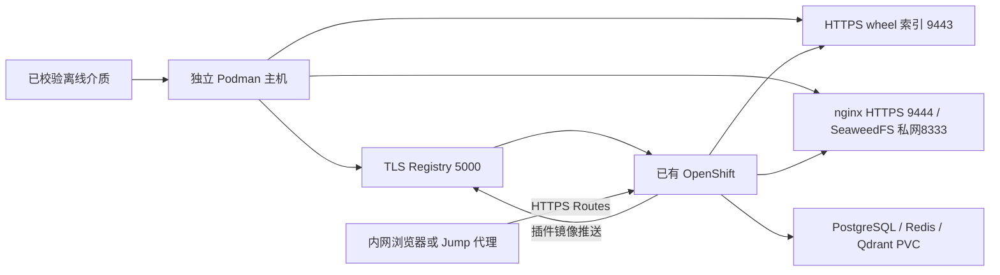

# Dify Enterprise 离线手工安装操作稿

本文供 Dify 同事按步骤手工重现安装，整理面向客户的手册。说明以当前客户 Ansible 实现为依据，操作命令在离线端直接使用 Podman、oc、Helm、jq/yq，不调用安装 Playbook。自动化主入口仍保持 Ansible，本篇没有新增另一个全流程脚本安装器。

操作范围：Dify Enterprise/Chart **3.9.8**、Linux amd64、RHEL 9 系、已有 OpenShift 4.20/4.21、namespace/release **dify**、单机 TLS Registry + wheel 索引 + 本地 SeaweedFS S3。已通过现场验证的是自动安装及修复后的验收；**本篇手工顺序仍需在空白目标完整执行验证**。命令和数据转换可做本地回归，不能据此声称手工现场安装已经通过。

本篇从**制作侧交付的可校验介质**开始；联网制作仍使用 [Quick Start 第 1～2 节](customer-quickstart.md)。这能让自动安装与手工安装使用同一批镜像、Chart及配置，手工复现离线安装不要求重新手工设计镜像清单。若将来单独编写纯手工制包手册，应另外检查它生成的文件结构、镜像身份和校验内容与本篇输入要求一致。

## 当前平台与插件验证范围

**截至 2026-11-06，已验证的是 Dify 平台部署和基础验收；尚未验证任何具体插件的离线安装、运行或完整离线业务。** 现场范围为 RHDP OpenShift 4.20.8；通过项包括平台/数据层 Pod、内网镜像引用、四个数据库、Redis、认证 TLS S3 读写删除、HTTPS 入口，以及 Chrome 页面加载。License 激活与插件/模型/RAG 不在通过项内。

| 层次 | 需要具备什么 | 当前验证结论 |
|---|---|---|
| 插件能安装 | 指定版本的 `.difypkg`、构建镜像、匹配 Python ABI/平台的完整依赖，以及签名/构建/推送链路 | 已提供本地 Registry、wheel 索引和构建基础镜像等准备机制；**尚未实际验证某个插件的离线安装/构建，不能声称这一层已通过** |
| 插件能运行 | 版本兼容，配置、权限、证书正确，运行实例可调用 | **未验证**，须选定插件逐个测试 |
| 插件能离线完成业务 | 插件所需的模型、API、数据或其他服务在客户内网可用，实际业务不依赖公网 | **未验证**，须逐项核对外部依赖并实际执行 |

wheel 索引只提供已经放入介质的 Python 依赖文件，可以合法为空；它不会自动补齐缺失依赖，也不存放模型权重或提供模型服务。插件安装成功也不等于离线业务可用，例如仍需公网天气 API 的插件不能仅凭安装成功就认定能离线使用。

本操作稿复现平台安装；其中插件构建镜像和 wheel 索引的准备命令不替代上表三层的实际测试。

## 阅读命令时的几个约定

命令里的变量名、文件名和产品字段必须保持原样；正文会解释它们的含义，不把真实字段名翻译成另一套不能执行的名称。

| 名称或写法 | 在本文中的含义 |
|---|---|
| RHEL / amd64 | Red Hat Enterprise Linux 系统；amd64 表示 x86 的 64 位 CPU 架构，不要求 CPU 品牌必须为 AMD |
| `oc` | 与 OpenShift 集群交互的命令行工具，用来查询、创建和更新资源 |
| Podman | 在离线主机上加载镜像并运行 Registry/nginx/SeaweedFS 容器的工具 |
| Helm / Chart / release / values | Helm 是安装工具；Chart 是模板包；release 是某次安装在集群中的名称，本文为 dify；values 是填写模板的配置 |
| `jq` / `yq` | 分别读取和转换 JSON、YAML 配置文件的命令行工具，不是安装服务 |
| JSON / YAML | 两种结构化配置文件格式，本文用工具转换，避免凭手工修改大段配置 |
| SHA256 / digest | SHA256 算法按文件或镜像内容计算的校验值；digest 表示该内容摘要，常写为 `sha256:...`，不是登录密码 |
| CA / TLS / HTTPS | CA 是签发证书的机构，本文也用它指该机构的公开证书；TLS 负责加密连接并验证证书，HTTPS 是使用 TLS 的 HTTP 访问 |
| PEM / CSR / SAN / PKI | PEM 是证书/密钥常用文本格式；CSR 是申请签发证书的请求；SAN 是证书允许的域名列表；PKI 是证书签发和信任体系，第 4 节说明如何使用 |
| Python ABI | Python 扩展包与解释器交互的二进制接口；依赖包必须匹配实际 Python 版本、系统和 CPU 平台 |
| License / RAG / HA | 分别指产品授权、检索增强生成业务、高可用部署；本篇平台安装成功不自动证明这些项目通过 |
| `$变量名` | 读取当前终端保存的变量值；例如 `$WORK/config.json` 是工作目录下的 config.json 文件 |
| `export` | 让从当前终端启动的子进程也能读到该环境变量；不是永久保存变量 |
| `> 文件` / `>> 文件` | 分别为新建或覆盖文件、在文件末尾追加；所以只对本文指定的输出文件使用，不能随意改成原始介质文件 |
| `命令一 \| 命令二` | 将前一个命令的输出交给后一个命令作为输入，不是两条互不相关的操作 |
| 行末的 `\` | 表示命令尚未结束，下一行继续；复制多行命令时应一起复制，不能只执行一行 |
| `>/dev/null` | 不显示正常输出；不代表跳过检查。检查失败仍会返回错误 |
| `--arg` / `--rawfile` / `--slurpfile` | jq 分别从参数取得字符串、从文件读取原始文本、从文件读取 JSON 数据；用于避免手工拼接和错误转义 |

## 1. 先看清安装结构



这里有两类机器：离线 Podman 主机运行三个本地基础服务；OpenShift 节点运行 Dify 及数据库容器。两者可以互相访问，但不是同一个概念。

- **Registry（容器镜像仓库）：**保存 Dify 平台镜像，以及插件构建后推送的镜像。TLS 表示使用证书校验和加密的 HTTPS 连接。
- **wheel 索引（Python 安装包目录）：**提供已搬入的 `.whl` 依赖文件，插件构建时从这里安装 Python 库。它不存放模型权重，也不提供模型推理接口。
- **SeaweedFS：**本篇使用的本地对象存储服务，通过 S3 接口读写上传文件、插件包等对象。对象存储中的 bucket 是存放这些对象的逻辑容器，类似一个独立的存储空间。
- **Route（OpenShift 应用访问入口）：**把浏览器对应用域名的 HTTPS 请求转给集群内服务。Router 是接收这些请求的集群组件；它的证书与 Podman 三个基础服务的证书分别配置。

本篇默认不安装 Git 服务、ArgoCD 自动同步服务、OpenShift Data Foundation（ODF）存储平台、单点登录（SSO）、模型服务或日志/追踪平台。内部 PostgreSQL、Redis 连接未启用 TLS，Qdrant 使用集群内 HTTP；如果客户要求内部通信加密，需要另行配置并验证。

PostgreSQL、Redis、Qdrant 分别申请 **30 GiB、5 GiB、30 GiB** 的持久化存储。PVC（PersistentVolumeClaim）是应用向 OpenShift 申请存储的对象；StorageClass 是客户集群中提供存储的配置名称。预留镜像、容器层、Registry、S3及备份空间；建议 Podman 主机数据盘至少60 GiB并按实际使用扩容，不以压缩包大小计算运行空间。客户提供稳定的内网域名解析（DNS）、可用的 StorageClass，以及具有集群管理员（cluster-admin）权限的 kubeconfig 文件。kubeconfig 保存访问集群的地址和认证配置，应作为私有文件管理。网络上，OpenShift 节点和 Pod（运行应用容器的工作单元）应能访问 Podman 主机的 5000、9443、9444 端口；运维主机应能访问集群 API 的 6443 端口和应用 HTTPS 入口的 443 端口。

**只在空白验证目标初装。** 手工安装期间，请勿在同一环境中同时运行其他安装或清理任务，避免相互干扰。不对正在使用的在线 GitOps或自动离线安装执行本篇；同名namespace、容器、Helm release存在时停止，不接管或删除。客户端未安装的功能、License、插件和模型不因Pod Ready就自动可用。

## 2. 准备文件、工具和操作终端

### 2.1 制作侧交付什么

由联网制作机管理员交付：

1. `dify-offline-3.9.8-linux-amd64.tar.gz`及同名`.sha256`，来源为已成功完成的`customer-prepare.yml`。
2. **同一已审核版本的完整工程源码压缩包及其SHA256**。本篇使用其中`docs/manual-offline/map-images.jq`、`resolve-values.jq`、`s3-probe.sh`；它们随源码提供，不假定已存在于旧bundle里。
3. OS离线软件及完整依赖：Podman、openssl、httpd-tools、tar、coreutils、jq **1.6或以上**，另提供 **Mike Farah yq v4.44.3** 的Linux amd64可执行文件。这里的yq不是Python同名包。oc/Helm使用bundle内的版本；纯手工操作不要求Ansible/Python。

工具在联网侧从客户可信软件源获取；yq来源为[官方固定版本发布页](https://github.com/mikefarah/yq/releases/tag/v4.44.3)，先核对发布方校验材料，再为实际交付的二进制生成SHA256随可信渠道搬运。不要让离线端运行curl、包管理器联网下载、Helm repo update或podman pull。

联网源镜像仓库的登录认证文件、客户 kubeconfig、服务私钥和产品 License 不放入公共安装包。`controller-wheels` 保存运行 Ansible 所需的 Python 包；它不等于插件所需的全部直接和间接依赖（依赖闭包）。本篇从完整源码中读取几个公开的数据处理文件，源码可通过压缩包取得，不要求客户安装 Git。

### 2.2 离线端设置路径

**第 2～13 节的安装命令均在离线 Podman 主机的 Bash 终端中以 root 用户执行。** 浏览器在本机的访问步骤另见第 13.1 节所链接的指南。下面会依次提示输入路径，这些值只保存在当前终端变量中，不会自动写入永久配置。

制作侧应已搬入安装压缩包、校验文件和完整源码，并将源码解包。目录分成以下几类，不能混用：

| 变量名 | 由谁设置、指向什么 | 路径示例及读写方式 |
|---|---|---|
| `MEDIA` | 你输入：安装压缩包和 `.sha256` 文件所在目录 | 如 `/mnt/dify-delivery`；先在这里校验和解包 |
| `SOURCE` | 你输入：完整工程源码解包后的根目录 | 如 `/mnt/dify-source`；只读，用于取得 `docs/manual-offline/` 中的文件 |
| `WORK` | 你输入：本次手工安装新建的私有工作目录 | 如 `/var/lib/dify-manual`；必须尚不存在，后续生成文件写在这里 |
| `BUNDLE` | 命令根据 `MEDIA` 设置为 `$MEDIA/bundle` | 上例为 `/mnt/dify-delivery/bundle`；保存解包后的原始安装材料，校验后只读取 |
| `STATE` | 命令根据 `WORK` 设置为 `$WORK/state` | 上例为 `/var/lib/dify-manual/state`；保存服务证书、认证和持久化数据 |
| `KUBECONFIG` | 你输入：客户管理员提供的集群访问配置文件路径 | 如 `/root/dify-private/kubeconfig`；读取其认证信息，不输出文件内容 |
| `CTX` | 你输入：该 kubeconfig 内客户确认的 context 名称 | context 是“集群、用户身份和默认命名空间”的一组命名配置；每条 oc/Helm 命令显式选择它 |

表中的路径仅用于说明，可选择客户实际目录；输入时填写完整绝对路径，不输入变量名或尚未展开的 `$HOME`，路径不要包含空格。`$WORK` 表示取得变量 WORK 中保存的路径，不是要求创建一个叫 WORK 的固定目录。

如果重新登录、切换到另一个终端或执行 `sudo -i`，这些变量可能不在新终端中。应重新设置为本次安装原来的值，**不是重新执行整个初装代码块**，也不能重新生成已有凭证或创建第二个工作目录。

```bash
# 遇到命令失败、未定义变量或管道中任一步失败即停止，避免带着错误继续安装。
set -euo pipefail
# 此终端新建的普通文件仅当前用户可读写，保护后续生成的凭证和私有清单。
umask 077
printf '介质tar.gz和sha256所在接收目录：'
read -r MEDIA
printf '已解包完整源码的根目录：'
read -r SOURCE
printf '本次手工安装的新私有工作目录（必须不存在）：'
read -r WORK
printf '客户kubeconfig绝对路径：'
read -r KUBECONFIG
export KUBECONFIG
printf '客户确认的context：'
read -r CTX
# 检查输入均为绝对路径；工作目录不能有空格、位于源码/介质内或经过符号链接。
[[ "$MEDIA" == /* && "$SOURCE" == /* && "$WORK" == /* && "$KUBECONFIG" == /* ]]
[[ "$WORK" != *[[:space:]]* && "$MEDIA" != *[[:space:]]* && "$SOURCE" != *[[:space:]]* ]]
[[ "$WORK" != "$MEDIA"/* && "$WORK" != "$SOURCE"/* ]]
test "$(realpath -m -- "$WORK")" = "$WORK"
# 创建刚才输入的 WORK 目录，保存这次安装产生的文件；目录已存在时停止，避免覆盖。
test ! -e "$WORK"
install -d -m 0700 "$WORK"
# 切到介质接收目录，按随包提供的 SHA256 校验压缩包。
cd "$MEDIA"
sha256sum -c dify-offline-3.9.8-linux-amd64.tar.gz.sha256
# 确认没有旧解包目录，再解出 bundle；已有且校验过的 bundle 按正文说明跳过这两行。
test ! -e bundle
tar --no-same-owner -xzf dify-offline-3.9.8-linux-amd64.tar.gz
# BUNDLE 保存原始材料，后续只读取其中的文件内容；新配置写到 WORK 指定的目录，服务密钥和数据写到它下面的 STATE 目录。
export BUNDLE="$MEDIA/bundle"
# 优先使用介质中已校验的 oc 和 Helm，不使用主机上可能版本不符的同名程序。
export PATH="$BUNDLE/bin:$PATH"
export STATE="$WORK/state"
install -d -m 0700 "$STATE"
# 确认完整源码已带上本文使用的数据过滤文件和 S3 探针。
test -f "$SOURCE/docs/manual-offline/map-images.jq"
# 确认完整源码已带上本文使用的数据过滤文件和 S3 探针。
test -f "$SOURCE/docs/manual-offline/resolve-values.jq"
# 确认完整源码已带上本文使用的数据过滤文件和 S3 探针。
test -f "$SOURCE/docs/manual-offline/s3-probe.sh"
# 核对工具版本：jq 1.6+、Mike Farah yq 4.44.3、包内 Helm 和主机 Podman。
jq --version
yq --version
helm version --short
podman --version
```

如果接收目录中已存在经过校验的 `bundle`，只跳过“检查 bundle 不存在”和“解包”两条命令，继续设置 `BUNDLE`。不要向旧目录覆盖解压另一份安装包。

`WORK` 应是这次安装专用的实际目录，不能放在 `SOURCE`、`BUNDLE` 或 Git 仓库内，也不能通过符号链接（指向另一路径的文件系统快捷方式）绕回这些位置。这样私钥、密码和中间文件不会混入源码或原始介质。

工具版本命令应显示 jq 1.6 或以上、Mike Farah yq 4.44.3，以及所用 Helm/Podman 的版本。如果提示命令不存在，先补齐工具；路径检查失败或任何操作报错时停止，不跳过失败的命令。

### 2.3 校验完整文件集合

外层SHA通过后，继续验证包内文件集合及内容；不能直接`sha256sum -c checksums.json`，它是JSON文件。下面限制文件名为本工程受控字符，拒绝路径穿越、额外文件和链接，任何不支持的文件名需重新审查交付包，不通过重写清单绕过。

```bash
# 先验证清单中的路径格式；-e 使条件不满足时返回失败。
jq -e 'all(keys[]; test("^[A-Za-z0-9_./+-]+$") and
  (startswith("/")|not) and (split("/")|index("..")|not))' \
  "$BUNDLE/checksums.json" >/dev/null
# 拒绝符号链接和特殊文件；这里只允许目录和普通文件。
test -z "$(find "$BUNDLE" ! -type f ! -type d -print -quit)"
# 生成清单期望的文件名集合；checksums.json 本身不在其自校验范围，单独加入。
jq -r 'keys + ["checksums.json"] | sort[]' "$BUNDLE/checksums.json" > "$WORK/expected-files"
# 生成实际文件名集合，随后用 diff 拒绝多余或缺失文件。
find "$BUNDLE" -type f -printf '%P\n' | LC_ALL=C sort > "$WORK/actual-files"
diff -u "$WORK/expected-files" "$WORK/actual-files"
# 将 JSON 摘要表转换成 sha256sum 可读取的格式，再逐文件核对内容。
jq -r 'to_entries[] | "\(.value)  \(.key)"' "$BUNDLE/checksums.json" > "$WORK/files.sha256"
(cd "$BUNDLE" && sha256sum -c "$WORK/files.sha256")
# 将配置文件和镜像记录列表转换成 JSON 格式，保存到工作目录供后续命令读取；原文件保持不变。
yq -o=json '.' "$BUNDLE/config.yaml" > "$WORK/config.json"
yq -o=json '.' "$BUNDLE/images.lock.yaml" > "$WORK/lock.json"
jq -e '.format == 1 and .status == "exported" and .platform == "linux/amd64" and (.images|length)>0' \
  "$WORK/lock.json" >/dev/null
```

本组检查的成功表现如下，并不是每条命令都会打印“通过”：

- `diff -u` 不输出差异，说明实际文件列表与包内清单一致，没有缺失或多余文件。
- `sha256sum -c` 对每个文件输出 `OK`；出现 `FAILED` 或文件不存在时停止。
- `test`、带 `>/dev/null` 的 `jq -e` 检查成功时通常没有输出；出现错误或命令返回失败时停止。
- `$WORK/config.json` 和 `$WORK/lock.json` 已生成，分别是原始配置和镜像列表的 JSON 形式，便于后续命令读取。

**后续新生成的文件写入 `WORK` 指向的目录，原始 `BUNDLE` 目录保持不变。** 例如 WORK 为 `/var/lib/dify-manual`，则配置、校验结果和渲染清单保存在该目录下；证书、认证及服务数据保存在它的 `state/` 子目录。BUNDLE 保存原始安装材料，后面只从中读取镜像、Chart 和配置。不把新文件放进去，也不修改其中的校验清单。这里的工作目录约定针对配置、校验结果、生成清单和私有状态文件；第 13.2 节会明确将服务定义复制到 `/etc/systemd/system/`。镜像加载后的内部存储由 Podman 管理，提交的集群资源保存在 OpenShift 中，这些操作也不会把内容写进 BUNDLE。

`images.lock.yaml` 是一张镜像记录表，每条记录含义如下：

| 字段 | 含义和后续用途 |
|---|---|
| `source` | 镜像原来的完整引用，例如源仓库、镜像名和 tag；用来找到它在目标内网仓库中的对应地址 |
| `resolvedSource` | 将源镜像简写补全后的完整仓库引用，用于记录实际拉取来源；不代替目标内网地址 |
| `sourceRegistryDigest`（可能没有） | 源仓库返回的摘要，仅用于追溯；与转成 OCI 归档后的摘要、目标仓库摘要不要求相同 |
| `archive` | 这个镜像的 OCI 归档文件路径，相对于 BUNDLE；如 `images/003.tar`，实际文件就是 `$BUNDLE/images/003.tar` |
| `imageId` | 归档中镜像配置内容的 SHA256 身份，以 `sha256:` 开头；Podman 加载归档后，后续操作使用这个身份选择镜像 |
| `sourceImageId` | 联网制作时源镜像的 ID，仅用于追溯；转成 OCI 归档后配置内容可能变化，因此它不一定等于 `imageId`，不能直接代替后者 |
| `sourceDigest` | 归档内选中的镜像 manifest 文件的 SHA256 摘要；第 6 节会重新计算并核对 |
| `roles` | 镜像在本地主机服务中的用途，如 registry、wheel-server、object-store；用于选出三个服务的基础镜像 |

OCI 是容器镜像的标准归档格式。manifest 是描述镜像配置和各层内容的文件，config 是记录镜像运行配置的文件；它们各有自己的摘要，不能把不同摘要当作同一个 ID 使用。

## 3. 核对现场配置和空白目标

`config.yaml` 在联网制作介质时已写入客户配置。以下命令读取其内容，并与当前集群比较；不要在离线端临时填写另一套域名使两边不一致。

| 本节变量 | 含义 | 后续用途 |
|---|---|---|
| `REGISTRY` | 本地镜像仓库的 `主机:端口` | 镜像推送、节点拉取及认证配置 |
| `HOST` / `REGISTRY_PORT` | 从 REGISTRY 分出的主机域名、仓库端口 | 证书域名检查及端口检查 |
| `PIP_URL` | Python 依赖索引的 HTTPS 地址 | 插件构建安装 Python 库；本篇应为 `https://HOST:9443/simple/`，HOST 使用实际值 |
| `S3_PORT` / `BUCKET` | 对象存储 HTTPS 端口、存储空间名称 | Dify 对象读写和后面的探针测试 |
| `APPS` | 客户 OpenShift 应用入口的域名后缀 | 拼出 Console、API 等六个应用域名 |
| `LOCK_SHA` | `images.lock.yaml` 文件整体的 SHA256 摘要 | 写入容器标签，记录本次容器与哪份镜像列表对应 |

例如 REGISTRY 为 `registry.customer.internal:5000`，HOST 就是 `registry.customer.internal`，REGISTRY_PORT 就是 `5000`。这些示例用于解释格式，不是要求照填。

```bash
# 从制包时固化的配置读出服务地址，不能在离线端另填一套与包不符的值。
REGISTRY=$(jq -r '.offline.registry' "$WORK/config.json")
HOST=${REGISTRY%:*}
REGISTRY_PORT=${REGISTRY##*:}
PIP_URL=$(jq -r '.offline.pipMirror' "$WORK/config.json")
S3_PORT=$(jq -r '.offline.localS3.port' "$WORK/config.json")
BUCKET=$(jq -r '.offline.localS3.bucket' "$WORK/config.json")
APPS=$(jq -r '.deployer.domain' "$WORK/config.json")
LOCK_SHA=$(sha256sum "$BUNDLE/images.lock.yaml" | awk '{print $1}')
export HOST REGISTRY REGISTRY_PORT PIP_URL S3_PORT BUCKET APPS LOCK_SHA
# 核对这份介质确实使用 dify 命名空间、amd64 架构、本地 S3 和本文端口；不符合时停止。
jq -e '.namespace == "dify" and .offline.platform == "linux/amd64" and
  .offline.localS3.enabled == true and .offline.localS3.port == 9444 and
  (.offline.pipMirror | endswith(":9443/simple/")) and
  .components.objectStorage.enabled == false and .components.minio.enabled == false' \
  "$WORK/config.json" >/dev/null
test "$REGISTRY_PORT" = 5000
test "$PIP_URL" = "https://$HOST:9443/simple/"
# 读取目标集群版本和应用域名，保存到私有工作目录作后续比较。
oc --context "$CTX" get clusterversion version -o json > "$WORK/cluster.json"
oc --context "$CTX" get ingress.config.openshift.io cluster -o json > "$WORK/ingress.json"
# 比较实际 ingress 域与介质域，避免把同一包安装到错误环境。
jq -e --arg apps "$APPS" '.spec.domain == $apps' "$WORK/ingress.json" >/dev/null
jq -e '.status.desired.version | test("^4\\.(20|21)\\.")' "$WORK/cluster.json" >/dev/null
# 查看节点状态；下面还用 JSON 明确校验 amd64 和 Ready。
oc --context "$CTX" get nodes -o wide
oc --context "$CTX" get nodes -o json > "$WORK/nodes.json"
jq -e '(.items|length)>0 and all(.items[];
  .status.nodeInfo.architecture=="amd64" and any(.status.conditions[]; .type=="Ready" and .status=="True"))' \
  "$WORK/nodes.json" >/dev/null
oc --context "$CTX" get clusteroperators
oc --context "$CTX" get storageclass
# 分别读取三个组件选择的 StorageClass，确认客户集群实际存在。
for component in postgresql redis qdrant; do
  storage_class=$(jq -er --arg c "$component" '.components[$c].storage.storageClassName | select(length>0)' "$WORK/config.json")
  oc --context "$CTX" get storageclass "$storage_class"
done
# 初装要求 namespace 不存在；发现已有安装时停止，不自动接管。
oc --context "$CTX" get ns dify --ignore-not-found -o name > "$WORK/existing-namespace"
test ! -s "$WORK/existing-namespace"
# 同样检查三个本地容器名未被使用，避免覆盖另一套服务。
for name in dify-offline-s3 dify-offline-registry dify-offline-pypi; do
  if podman --cgroup-manager=cgroupfs container exists "$name"; then
    printf '同名容器已存在，停止：%s\n' "$name"
    exit 1
  fi
done
# 确认 Podman 服务主机名可以从当前主机解析；节点/Pod连通性还需后续验证。
getent ahostsv4 "$HOST"
```

检查结果应满足：节点状态为 `Ready`，CPU 架构为 `amd64`；ClusterOperator（管理集群组件的控制器）均为 `Available=True`、`Progressing=False`、`Degraded=False`；配置中三个 StorageClass 都能查询到。namespace 查询结果应为空，本机也不应已有同名容器。

本篇固定使用 5000、9443、9444 三个端口。若要改端口，必须同时修改服务配置、端口映射、应用 endpoint 和检查命令后重新验证。公共 `values-disconnected.yaml` 还会被客户配置覆盖，因此不能直接拿它代替最终的 `bundle/config.yaml`；最终文件才记录实际对象存储开关、主机、端口和存储类。

## 4. 生成稳定凭证和TLS

### 4.1 首次安装与中断后继续操作

首次安装需要准备服务证书、Registry 密码和 S3 凭证。**本节的生成命令只执行一次。** 如果安装中断后继续操作，应保留并复用已经生成的文件，从失败的位置继续；不要从本节开头重新生成一套证书和密码。否则，已启动的服务、客户端或集群 Secret 可能仍使用旧值，造成证书校验或认证失败。

### 4.2 私有文件的权限

这些目录和文件包含私钥、密码等内容：

- **目录权限 `0700`：**只有当前用户能查看、修改和进入目录；本篇以 root 操作，因此只有 root 可以访问。
- **`umask 077`：**限制本终端后续新建文件的默认权限，普通文件通常为 `0600`，只有当前用户能读写。它不会自动修改已经存在的文件权限，后面的 `chmod 0600` 用于明确收紧已有文件权限。

### 4.3 选择证书来源

下面两种方式选择一种，不能先放入客户证书，再执行生成命令覆盖它。

**方式一：实验环境自行生成。** 如果现场允许自建私有 CA，执行下面代码中的证书生成命令，创建 CA、服务私钥、证书请求（CSR）及服务证书。文中生成的 CA 和服务证书有效期均为 **365 天**，后续需要安排到期前更新。

**方式二：使用客户已有证书。** 请客户证书管理员准备下面三个 PEM 文件，在创建 `certificates` 目录后放到对应位置。跳过代码中的“生成本地 CA”“生成服务私钥和 CSR”“写入 SAN 约束”“签发服务证书”四组命令；继续执行证书验证、复制挂载文件以及后续认证配置。客户证书按其实际有效期管理，不受文中 365 天设置影响。

| 保存位置 | 文件内容 |
|---|---|
| `$STATE/certificates/server.crt` | Podman 主机提供 HTTPS 服务的证书，按客户 PKI 要求包含需要发送的中间证书链 |
| `$STATE/certificates/server.key` | 与 `server.crt` 配套的服务私钥 |
| `$STATE/certificates/ca.crt` | 用于验证服务证书的 CA 证书链；不是服务私钥，也不是 CA 签发私钥 |

`STATE` 已在第 2.2 节设置为 `$WORK/state`。例如 WORK 是 `/var/lib/dify-manual`，服务证书应放在 `/var/lib/dify-manual/state/certificates/server.crt`。使用客户证书时无需取得或提供 CA 的签发私钥 `ca.key`。

**证书必须对实际服务域名有效。** `HOST` 是第 3 节从配置中读出的 Podman 主机域名；SAN 是服务证书允许使用的域名列表。例如 HOST 为 `registry.customer.internal`，`server.crt` 的 SAN 必须包含这个域名。下面的 `openssl verify -verify_hostname` 会同时检查证书链和这个域名，验证失败时停止，不继续启动服务。

### 4.4 执行准备命令

先按上面的选择执行对应证书步骤，Registry/S3 凭证部分仍按首次安装流程执行。

```bash
# 创建私有持久化目录；证书、认证、Registry 和 S3 数据分别保存。
install -d -m 0700 "$STATE/certificates" "$STATE/tls" "$STATE/auth" \
  "$STATE/registry-data" "$STATE/s3-data" "$STATE/podman-certs" "$WORK/keys"
# 生成本地 CA 证书和私钥；客户提供正式 PKI 时按正文跳过这些生成步骤。
openssl req -x509 -newkey rsa:3072 -nodes -days 365 \
  -keyout "$STATE/certificates/ca.key" -out "$STATE/certificates/ca.crt" \
  -subj '/CN=Dify Offline CA' -addext 'basicConstraints=critical,CA:TRUE'
# 生成服务私钥和 CSR，CN 使用配置中的真实 Podman 主机名。
openssl req -new -newkey rsa:3072 -nodes \
  -keyout "$STATE/certificates/server.key" -out "$STATE/certificates/server.csr" -subj "/CN=$HOST"
# 写入 SAN、非 CA 及 serverAuth 约束，供下一条签发叶子证书。
printf 'subjectAltName=DNS:%s\nbasicConstraints=critical,CA:FALSE\nextendedKeyUsage=serverAuth\n' \
  "$HOST" > "$STATE/certificates/server.ext"
# 使用本地 CA 签发服务证书，有效期 365 天。
openssl x509 -req -days 365 -in "$STATE/certificates/server.csr" \
  -CA "$STATE/certificates/ca.crt" -CAkey "$STATE/certificates/ca.key" -CAcreateserial \
  -extfile "$STATE/certificates/server.ext" -out "$STATE/certificates/server.crt"
# 验证证书链及主机名；失败时不要继续启动服务。
openssl verify -CAfile "$STATE/certificates/ca.crt" -verify_hostname "$HOST" "$STATE/certificates/server.crt"
# 为容器准备证书挂载目录；Podman 客户端的 CA 单独复制到 podman-certs。
cp "$STATE/certificates/server.crt" "$STATE/tls/server.crt"
cp "$STATE/certificates/server.key" "$STATE/tls/server.key"
cp "$STATE/certificates/ca.crt" "$STATE/podman-certs/ca.crt"
# 生成 Registry 密码到私有文件，不把密码放进命令参数。
openssl rand -hex 32 > "$WORK/keys/registry-password"
# 通过标准输入生成 offline 用户的 bcrypt 校验值，供 Registry 验证登录。
htpasswd -niB offline < "$WORK/keys/registry-password" > "$STATE/htpasswd"
cp "$STATE/htpasswd" "$STATE/auth/htpasswd"
# 生成目标 Registry auth.json：键为主机:端口，auth 为 offline:密码的 base64。
jq -n --arg registry "$REGISTRY" --rawfile password "$WORK/keys/registry-password" \
  '{auths:{($registry):{auth:(("offline:"+($password|rtrimstr("\n")))|@base64)}}}' > "$STATE/auth.json"
# 生成对象存储访问账号和密钥，保存到私有 JSON 和环境变量文件；第 7.2 节从 JSON 取出这两个值供集群应用使用。
openssl rand -hex 12 > "$WORK/keys/s3-access"
openssl rand -hex 32 > "$WORK/keys/s3-secret"
jq -n --arg bucket "$BUCKET" --rawfile access "$WORK/keys/s3-access" --rawfile secret "$WORK/keys/s3-secret" \
  '($access|rtrimstr("\n")) as $a | ($secret|rtrimstr("\n")) as $s | {bucket:$bucket,accessKey:("dify"+$a),secretKey:$s}' \
  > "$STATE/local-s3.json"
# 把 S3 JSON 转成 SeaweedFS 容器所需的三行环境变量文件。
jq -r '["AWS_ACCESS_KEY_ID=" + .accessKey, "AWS_SECRET_ACCESS_KEY=" + .secretKey, "S3_BUCKET=" + .bucket] | join("\n")' \
  "$STATE/local-s3.json" > "$STATE/local-s3.env"
# 收紧证书和凭证文件权限，不向终端打印内容。
chmod 0600 "$STATE"/*.json "$STATE"/*.env "$STATE/htpasswd" "$STATE"/certificates/* "$STATE"/tls/* "$STATE"/auth/*
```

### 4.5 这些密码文件分别给谁使用

执行上面的命令后，主机上会生成两套不同用途的登录信息：一套用于本地镜像仓库，另一套用于本地对象存储。它们不是同一个账号，也不能互相替换。

**本地镜像仓库：服务端检查密码，客户端提供账号和密码。**

1. 本节生成一个名为 `offline` 的仓库账号和随机密码。`$STATE/htpasswd` 保存该密码的 bcrypt 校验结果，并复制到 `$STATE/auth/htpasswd`。第 5 节启动 Registry 容器时，会将后一个文件挂载到容器内的 `/auth/htpasswd`；仓库服务读取它，用来判断登录请求中的密码是否正确。
2. `$STATE/auth.json` 是给访问仓库的客户端使用的登录文件。它记录本地仓库的“域名:端口”，以及 `offline` 账号和密码合成后的 base64 文本。base64 可以解码恢复内容，所以这个文件仍然包含可使用的登录凭证，不是可以公开分享的普通配置。
3. 第 6 节的 `podman push --authfile` 读取这个登录文件，将镜像推送到本地仓库。第 7.2 节又把这个文件的内容写入 OpenShift 的 `offline-registry-pull` 和 `image-repo-secret` 两个 Secret，分别供工作负载拉取镜像、插件构建流程访问仓库使用。Registry 服务端本身读取的是 htpasswd 文件，不是这个 auth.json。

联网制作机还有一份**源镜像仓库的登录文件**，用于从 Docker Hub、Quay 等原始仓库下载镜像。它记录的是源仓库的地址和源仓库账号；这里新生成的 auth.json 记录的是客户本地仓库的地址和本地账号。两者服务对象不同，即使都采用 JSON 格式，也不能直接互换。

**本地对象存储：主机服务和集群应用使用相同的访问账号及密钥。**

`$STATE/local-s3.json` 保存 `bucket`、`accessKey`、`secretKey` 三个字段。bucket 是本次使用的存储空间名称；accessKey 是访问账号标识，secretKey 是与它配套的访问密钥。后续有两条读取路径：

| 文件中的字段 | 第 4～5 节：交给本机 SeaweedFS 服务 | 第 7.2 节：交给 OpenShift 中的 Dify |
|---|---|---|
| `accessKey` | 写入 `$STATE/local-s3.env` 的 `AWS_ACCESS_KEY_ID`，启动容器时通过 `--env-file` 读取 | 提取为私有文件，再写入 `dify-local-s3` Secret 的 `accessKey` 字段 |
| `secretKey` | 写入同一环境变量文件的 `AWS_SECRET_ACCESS_KEY` | 提取为私有文件，再写入同一 Secret 的 `secretKey` 字段 |
| `bucket` | 写入同一环境变量文件的 `S3_BUCKET` | 不写入该 Secret；第 9 节应用配置使用第 3 节取得的同一 bucket 名称 |

因此，**不是把整个 local-s3.json 文件原样转换成一个 Secret**。第 7.2 节只取其中两个认证字段；第 9 节生成应用配置时再读取该 Secret，让 Dify 用与 SeaweedFS 服务相同的凭证访问对象存储。两侧的值不同，就会出现服务正在运行但应用认证失败的情况。

**这些文件的保存和查看方式。** 上述文件保存在 STATE 指定的私有目录中。例如 WORK 为 `/var/lib/dify-manual`，则本地仓库登录文件位于 `/var/lib/dify-manual/state/auth.json`，对象存储登录文件位于 `/var/lib/dify-manual/state/local-s3.json`。按前面的设置限制目录和文件权限，不将文件内容直接贴到聊天、邮件、截图或公开文档中；同事理解流程只需要文件用途和字段名，不需要真实密码。

生成仓库密码时，密码先保存在 `$WORK/keys/registry-password`，`htpasswd` 命令从这个文件接收标准输入，生成密码校验结果；生成 auth.json 的 `jq` 命令也从文件读取密码。第 6 节 `podman push` 的 `--authfile` 参数指定登录文件的路径，第 7.2 节 `oc create secret` 的 `--from-file` 参数也指定文件路径，不把真实密码拼成你在终端输入的命令。这样可以避免这些命令把真实密码写入命令历史或直接显示在参数列表中；文件本身仍含敏感内容，仍需按前面的权限保存。

## 5. 手工加载服务镜像并启动三个容器

先根据镜像列表中 `roles` 字段，找到分别运行 Registry、nginx 和 SeaweedFS 的三个镜像，并从对应本地归档加载。`REGISTRY_ID`、`NGINX_ID`、`S3_ID` 变量分别保存这三个镜像的 `imageId`。第 6 节会把列表中的全部镜像推送到本地仓库；不能凭文件编号猜哪个是服务镜像。

```bash
# 按 lock 中 roles 选择基础服务镜像，只从本地 OCI 归档加载。
jq -r '.images[] | select((.roles|length)>0) | .archive' "$WORK/lock.json" |
while IFS= read -r archive; do
  # 校验通过后加载归档；普通镜像直接推送，构建基础镜像先加入私有 CA。
  podman --cgroup-manager=cgroupfs load -i "$BUNDLE/$archive"
done
# 读取可加载的 OCI imageId，不能用源 Docker ID 或凭镜像编号猜角色。
REGISTRY_ID=$(jq -r '.images[] | select(.roles|index("registry")) | .imageId' "$WORK/lock.json")
NGINX_ID=$(jq -r '.images[] | select(.roles|index("wheel-server")) | .imageId' "$WORK/lock.json")
S3_ID=$(jq -r '.images[] | select(.roles|index("object-store")) | .imageId' "$WORK/lock.json")
test -n "$REGISTRY_ID" && test -n "$NGINX_ID" && test -n "$S3_ID"
# 写入 nginx 配置：9443 提供 wheel 索引，9444 把认证 S3 请求转发到私网服务。
cat > "$STATE/nginx.conf" <<'NGINX'
events {}
http {
  server {
    listen 9443 ssl;
    ssl_certificate /certs/server.crt;
    ssl_certificate_key /certs/server.key;
    root /usr/share/nginx/html;
    location /simple/ { autoindex off; }
  }
  server {
    listen 9444 ssl;
    ssl_certificate /certs/server.crt;
    ssl_certificate_key /certs/server.key;
    client_max_body_size 0;
    location / {
      proxy_pass http://dify-offline-s3:8333;
      proxy_set_header Host $http_host;
      proxy_request_buffering off;
      proxy_buffering off;
    }
  }
}
NGINX
# 创建专用容器网络；SeaweedFS 的 8333 端口不发布到主机。
podman --cgroup-manager=cgroupfs network create dify-offline
# 创建 S3 容器：只用已加载的镜像，从私有环境变量文件取认证，/data 对应主机持久化目录，只接入专用容器网络。
podman --cgroup-manager=cgroupfs create --name dify-offline-s3 --pull=never \
  --restart=unless-stopped --label "io.dify.offline.bundle=$LOCK_SHA" \
  --network dify-offline --user 0 --env-file "$STATE/local-s3.env" \
  -v "$STATE/s3-data:/data:Z" "$S3_ID" mini -dir=/data
# 创建 TLS Registry：发布 5000，并挂载持久化数据、共用证书及 htpasswd。
podman --cgroup-manager=cgroupfs create --name dify-offline-registry --pull=never \
  --restart=unless-stopped --label "io.dify.offline.bundle=$LOCK_SHA" -p 5000:5000 \
  -v "$STATE/registry-data:/var/lib/registry:Z" -v "$STATE/tls:/certs:ro,z" -v "$STATE/auth:/auth:ro,Z" \
  -e REGISTRY_HTTP_TLS_CERTIFICATE=/certs/server.crt -e REGISTRY_HTTP_TLS_KEY=/certs/server.key \
  -e REGISTRY_AUTH=htpasswd -e REGISTRY_AUTH_HTPASSWD_REALM=offline \
  -e REGISTRY_AUTH_HTPASSWD_PATH=/auth/htpasswd "$REGISTRY_ID"
# 创建 nginx：只读挂载索引/配置，发布 9443 和 9444，证书目录使用共享 SELinux 标签。
podman --cgroup-manager=cgroupfs create --name dify-offline-pypi --pull=never \
  --restart=unless-stopped --label "io.dify.offline.bundle=$LOCK_SHA" --network dify-offline \
  -p 9443:9443 -p 9444:9444 -v "$BUNDLE/pypi:/usr/share/nginx/html:ro,Z" \
  -v "$STATE/tls:/certs:ro,z" -v "$STATE/nginx.conf:/etc/nginx/nginx.conf:ro,Z" "$NGINX_ID"
# 按 S3 → Registry → nginx 顺序启动，再查看容器状态。
podman --cgroup-manager=cgroupfs start dify-offline-s3 dify-offline-registry dify-offline-pypi
podman --cgroup-manager=cgroupfs ps
# 将带有仓库登录信息的 HTTP 认证头写入私有文件；curl 从文件读取，不把真实认证内容写进命令参数。
jq -r --arg registry "$REGISTRY" '.auths[$registry].auth | "Authorization: Basic "+.' \
  "$STATE/auth.json" > "$WORK/registry-header"
# 验证 Registry 认证与 TLS；下一项验证 wheel 索引，最后一项应返回匿名 S3 的 403。
curl --noproxy '*' --cacert "$STATE/certificates/ca.crt" --header "@$WORK/registry-header" \
  --fail --retry 10 --retry-connrefused "https://$REGISTRY/v2/"
curl --noproxy '*' --cacert "$STATE/certificates/ca.crt" --fail "https://$HOST:9443/simple/"
curl --noproxy '*' --cacert "$STATE/certificates/ca.crt" -sS -o /dev/null -w 'HTTP %{http_code}\n' "https://$HOST:9444/"
```

`podman ps` 应列出三个容器且状态为运行中。Registry 的认证请求和 wheel 索引请求应成功，匿名访问 S3 根路径应返回 `HTTP 403`，表示没有凭证的访问被拒绝；这一步还没有证明携带凭证的 S3 读写正常，第 12 节会继续测试。

容器命令中的 `-p 主机端口:容器端口` 表示端口转发，`-v 主机路径:容器路径` 表示文件或目录挂载；`:ro` 表示容器只读挂载。SELinux 是主机的文件访问控制机制，`:z` 为多个容器共用的目录设置共享标签，`:Z` 为单个容器设置独占标签。本篇两个容器共用 TLS 目录，所以该目录使用 `:z`；不要随意全部改成 `:Z`。

S3 后端的 8333 和管理端口没有发布到主机，外部只访问 nginx 的 9444。wheel 索引没有账号认证，客户应限制其网络访问范围。若服务刚启动尚未就绪，只重做末尾的访问检查；不要重复执行创建容器的 `create` 命令。

## 6. 将所有镜像导入本地Registry

下面对镜像列表逐条处理，变量 `i` 从 0 开始。第一条目标仓库为 `REGISTRY/dify-offline/image-000`，第二条为 `image-001`，以此类推；REGISTRY 使用第 3 节读出的实际地址。编号取自列表原顺序，不再重新排序。

每个归档先检查 manifest/config 文件的内容摘要和 CPU 架构，再由 `podman load` 加载。普通镜像使用其 `imageId` 推送。Kaniko（插件镜像构建工具）和 Python 插件构建基础镜像需要额外放入本地 CA，所以先在本机生成加入 CA 后的新镜像；`push_id` 保存实际要推送的镜像 ID，可能已不同于原归档的 `imageId`。

`podman push` 把镜像上传到内网仓库，`target_digest` 保存仓库接收后得到的 manifest 内容摘要。最终应用使用 `仓库地址@sha256:摘要` 拉取确定内容，不能拿源仓库摘要或配置 ID 代替这个目标摘要。

```bash
# 初始化目标镜像映射；必须等本节全部导入成功才能用于部署。
printf '{}\n' > "$STATE/image-map.json"
COUNT=$(jq '.images|length' "$WORK/lock.json")
# 按 lock 原始索引逐张导入；三位编号由此索引生成，不重新排序。
for ((i=0; i<COUNT; i++)); do
  source=$(jq -r --argjson i "$i" '.images[$i].source' "$WORK/lock.json")
  archive=$(jq -r --argjson i "$i" '.images[$i].archive' "$WORK/lock.json")
  image_id=$(jq -r --argjson i "$i" '.images[$i].imageId' "$WORK/lock.json")
  source_digest=$(jq -r --argjson i "$i" '.images[$i].sourceDigest' "$WORK/lock.json")
  # 读取 OCI 索引，验证只有一个 manifest，再逐级验证 manifest/config 摘要和架构。
  tar -xOf "$BUNDLE/$archive" index.json > "$WORK/oci-index.json"
  jq -e '.manifests|length==1' "$WORK/oci-index.json" >/dev/null
  digest=$(jq -r '.manifests[0].digest' "$WORK/oci-index.json")
  test "$digest" = "$source_digest"
  tar -xOf "$BUNDLE/$archive" "blobs/sha256/${digest#sha256:}" > "$WORK/oci-manifest.json"
  test "sha256:$(sha256sum "$WORK/oci-manifest.json" | awk '{print $1}')" = "$digest"
  config_digest=$(jq -r '.config.digest' "$WORK/oci-manifest.json")
  test "$config_digest" = "$image_id"
  tar -xOf "$BUNDLE/$archive" "blobs/sha256/${config_digest#sha256:}" > "$WORK/oci-config.json"
  test "sha256:$(sha256sum "$WORK/oci-config.json" | awk '{print $1}')" = "$image_id"
  jq -e '.os=="linux" and .architecture=="amd64"' "$WORK/oci-config.json" >/dev/null
  # 校验通过后加载归档；普通镜像直接推送，构建基础镜像先加入私有 CA。
  podman --cgroup-manager=cgroupfs load -i "$BUNDLE/$archive"
  push_id=$image_id
  # 只对 Kaniko 和 Python 构建基础镜像派生 CA 镜像，处理动态插件构建时的 TLS 信任。
  if [[ "$source" == *kaniko-project/executor* || "$source" == */plugin-build-base-python:* ]]; then
    builddir=$(mktemp -d "$STATE/ca-build.XXXXXX")
    cp "$STATE/certificates/ca.crt" "$builddir/ca.crt"
    podman --cgroup-manager=cgroupfs tag "$image_id" "localhost/dify-offline-base:$i"
    printf 'FROM localhost/dify-offline-base:%s\n' "$i" > "$builddir/Containerfile"
    if [[ "$source" == *kaniko-project/executor* ]]; then
      printf 'COPY ca.crt /kaniko/ssl/certs/offline-registry.crt\nENV SSL_CERT_DIR=/kaniko/ssl/certs\n' >> "$builddir/Containerfile"
    else
      printf 'COPY ca.crt /opt/offline-ca.crt\nENV SSL_CERT_FILE=/opt/offline-ca.crt REQUESTS_CA_BUNDLE=/opt/offline-ca.crt PIP_CERT=/opt/offline-ca.crt UV_NATIVE_TLS=true\n' >> "$builddir/Containerfile"
    fi
    # 禁止构建工具联网或补拉基础镜像；保存加入 CA 后的新镜像 ID，随后删除本次临时构建目录。
    podman --cgroup-manager=cgroupfs build --pull=never --network=none --iidfile "$builddir/image-id" "$builddir"
    push_id=$(cat "$builddir/image-id")
    rm -r -- "$builddir"
  fi
  # 生成本条镜像在本地 Registry 的稳定编号仓库。
  printf -v repository '%s/dify-offline/image-%03d' "$REGISTRY" "$i"
  # 通过私有 CA 和目标 authfile 推送，将实际目标 manifest digest 写入文件。
  podman --cgroup-manager=cgroupfs push --authfile "$STATE/auth.json" --cert-dir "$STATE/podman-certs" \
    --digestfile "$STATE/push-digest" "$push_id" "docker://$repository:bundle"
  target_digest=$(cat "$STATE/push-digest")
  [[ "$target_digest" =~ ^sha256:[a-f0-9]{64}$ ]]
  # 记录原镜像地址对应的“内网仓库@内容摘要”；先写 .next 文件，写完才替换正式映射表，避免半写入文件被后续读取。
  jq --arg source "$source" --arg target "$repository@$target_digest" '. + {($source):$target}' \
    "$STATE/image-map.json" > "$STATE/image-map.json.next"
  mv "$STATE/image-map.json.next" "$STATE/image-map.json"
  printf '已导入 %s/%s：%s\n' "$((i+1))" "$COUNT" "$source"
done
test "$(jq 'length' "$STATE/image-map.json")" = "$COUNT"
```

循环每完成一张镜像会显示“已导入 当前数量/总数”，最后一条检查确认映射条数等于镜像总数。`$STATE/image-map.json` 保存每个 `source` 对应的内网仓库及目标摘要，第 8～10 节据此替换安装清单中的镜像引用。

`builddir` 是本次临时构建目录，`Containerfile` 说明如何在已加载镜像中加入公开 CA；`--pull=never --network=none` 表示不拉取外部镜像，构建时也不接通网络。完成构建后只删除这个临时目录，不删除服务数据。

任何一张导入失败都应停止，映射未完整时不能进入部署。如果需要重做本节，保留仓库、CA 和密码；本节会重新验证并推送全部镜像，重新生成映射表，不要回到第 4 节生成另一套身份。

## 7. 配置节点CA、namespace和Secret

### 7.1 合并节点信任

节点需要信任 Registry 证书，才能拉取内网镜像。ConfigMap 是 Kubernetes 保存配置数据的对象；本节使用它保存公开的 CA 证书，不保存私钥。

先读取集群当前引用的 CA ConfigMap 名称，保存到 `TRUST_CM`。如果客户已经有该对象，只增加本 Registry 对应的条目，保留其他仓库的证书；没有引用时才使用专用名称 `dify-offline-registry-cas`。

ConfigMap 的数据键采用 `主机..端口` 格式。例如仓库地址为 `registry.customer.internal:5000`，数据键为 `registry.customer.internal..5000`，值是 CA 的 PEM 文本。`resourceVersion` 是读取时该集群对象的版本号；更新前先比较它，若其他管理员已经修改过对象，本次更新应失败并重新核对，不能静默覆盖。

```bash
# 读取已有 CA 配置名称及对象版本号，后续在此基础上增加本仓库证书，保留客户其他配置。
oc --context "$CTX" get image.config.openshift.io cluster -o json > "$WORK/image-config.json"
TRUST_CM=$(jq -r '.spec.additionalTrustedCA.name // ""' "$WORK/image-config.json")
if [[ -z "$TRUST_CM" ]]; then TRUST_CM=dify-offline-registry-cas; fi
oc --context "$CTX" -n openshift-config get cm "$TRUST_CM" --ignore-not-found -o json > "$WORK/trust-existing.json"
# 生成要增加的公开 CA 条目；名称中的主机:端口转成主机..端口，只更新本仓库的条目。
jq -n --arg key "${REGISTRY//:/..}" --rawfile ca "$STATE/certificates/ca.crt" \
  '{data:{($key):$ca}}' > "$WORK/ca-patch.json"
# 已有 ConfigMap 就合并一个键；没有才创建，不清空客户其他 CA。
if [[ -s "$WORK/trust-existing.json" ]]; then
  oc --context "$CTX" -n openshift-config patch cm "$TRUST_CM" --type=merge --patch-file "$WORK/ca-patch.json"
else
  oc --context "$CTX" -n openshift-config create configmap "$TRUST_CM" \
    --from-file="${REGISTRY//:/..}=$STATE/certificates/ca.crt"
fi
# 更新前先比较读取时的对象版本号；如果别人已改过配置就停止，避免覆盖对方修改。
jq --arg name "$TRUST_CM" '[
  {op:"test",path:"/metadata/resourceVersion",value:.metadata.resourceVersion},
  {op:"add",path:"/spec/additionalTrustedCA",value:{name:$name}}]' \
  "$WORK/image-config.json" > "$WORK/image-patch.json"
oc --context "$CTX" patch image.config.openshift.io cluster --type=json --patch-file "$WORK/image-patch.json"
oc --context "$CTX" get machineconfigpools
# 信任配置提交后创建本次应用 namespace。
oc --context "$CTX" create namespace dify
```

提交 CA 配置后，要等待节点收到并应用新配置。`machineconfigpools` 显示节点配置组的更新状态，应恢复为 `UPDATED=True`、`UPDATING=False`、`DEGRADED=False`；后面的 Pod 实际拉取成功，才说明认证、证书和网络一起正常，不能只根据 ConfigMap 创建成功作判断。

本节还创建名为 `dify` 的应用命名空间（namespace，用于集中管理这一套应用资源）。更新集群 CA，以及后面安装自定义资源定义和安全策略，需要集群管理员权限；仅有该命名空间管理员权限不够。

### 7.2 创建目标认证与稳定应用密钥

下面的create操作用于新namespace；已有同名Secret时先停止核对，不用覆盖或随机轮换来“修复”。

```bash
# 创建镜像拉取凭证；只传入私有文件路径，不在命令行提供真实密码。
oc --context "$CTX" -n dify create secret generic offline-registry-pull \
  --type=kubernetes.io/dockerconfigjson --from-file=.dockerconfigjson="$STATE/auth.json"
# 插件构建推送凭证必须包含 .dockerconfigjson 和 config.json 两个键。
oc --context "$CTX" -n dify create secret generic image-repo-secret \
  --type=kubernetes.io/dockerconfigjson --from-file=.dockerconfigjson="$STATE/auth.json" --from-file=config.json="$STATE/auth.json"
# 应用/探针使用服务 CA；它不替代节点拉取信任或浏览器 Route CA。
oc --context "$CTX" -n dify create secret generic offline-registry-ca --from-file=ca.crt="$STATE/certificates/ca.crt"
# 首次生成三项稳定应用密钥，写无末尾换行的私有文件。
for key in appSecretKey innerApiKey dashboardSecretKey; do
  openssl rand -hex 28 | tr -d '\n' > "$WORK/keys/$key"
done
# 从文件创建应用密钥 Secret，后续 values 按键引用它们。
oc --context "$CTX" -n dify create secret generic dify-offline-keys \
  --from-file=appSecretKey="$WORK/keys/appSecretKey" --from-file=innerApiKey="$WORK/keys/innerApiKey" \
  --from-file=dashboardSecretKey="$WORK/keys/dashboardSecretKey"
# S3 Secret 复用主机已创建的身份；-j 不在值后追加换行。
jq -j '.accessKey' "$STATE/local-s3.json" > "$WORK/keys/s3-access-value"
jq -j '.secretKey' "$STATE/local-s3.json" > "$WORK/keys/s3-secret-value"
oc --context "$CTX" -n dify create secret generic dify-local-s3 \
  --from-file=accessKey="$WORK/keys/s3-access-value" --from-file=secretKey="$WORK/keys/s3-secret-value"
```

Secret 是 Kubernetes 保存凭证类数据的对象。`image-repo-secret` 是 Dify 插件构建流程使用的固定对象名，必须同时包含 `.dockerconfigjson` 和 `config.json` 两个字段，二者内容都是本地 Registry 的认证 JSON，不能省掉其中一个。

`dify-offline-keys` 保存三项应用密钥；这些值以后仍要使用，尤其已有业务数据后不能重新随机生成。`dify-local-s3` 的 accessKey/secretKey 必须与第 4 节本机 S3 身份一致，否则即使服务正在运行，应用仍会认证失败。

本节每条 `oc create secret` 应显示对应 Secret 已创建；只确认对象名和字段是否存在，不把字段值打印或贴到共享记录中。

## 8. 生成并安装依赖资源

Chart 是 Helm 的应用安装模板包，values 是填写模板所需的配置。这里每个数据库/前置组件各有一个子 Chart。总配置把 PostgreSQL 参数放在 `components.postgresql` 下，但 PostgreSQL 子 Chart 读取顶层 `postgresql`，所以要先转换配置层级，不能直接把原 `config.yaml` 传给子 Chart。

下面逐组生成配置文件，使用 `helm template` 在本机将模板展开成具体资源文件，再用 `oc apply` 提交给集群。生成的配置和清单保存在 `$WORK/dependencies/`；`COMPONENTS` 保存包内子 Chart 所在路径。`field` 是总配置中的组件键，`chart` 是其实际 Chart 目录名。每一组等依赖就绪后才处理下一组。

```bash
# 创建依赖资源的私有输出目录，使用包内本地子 Chart。
install -d -m 0700 "$WORK/dependencies"
COMPONENTS="$BUNDLE/source/examples/helm/components"
# 依次安装前置权限和凭证、自定义插件资源类型、PostgreSQL、Redis、Qdrant；当前组未就绪时不处理下一组。
for pair in prereqs:dify-prereqs pluginCrds:plugin-crds postgresql:postgresql redis:redis qdrant:qdrant; do
  field=${pair%%:*}
  chart=${pair#*:}
  # 插件资源类型的安装模板读取 plugin_controller 配置，与数据库模板不同，因此单独生成它的配置文件。
  if [[ "$field" == pluginCrds ]]; then
    printf '{"plugin_controller":{"installCrd":true}}\n' > "$WORK/dependencies/$chart-values.json"
  else
    # 从总配置的 components 中取出当前组件，放到该子 Chart 要求的顶层键，并关闭不用于本次离线安装的在线任务。
    jq --arg field "$field" '
      {($field):(.components[$field] + {namespace:"dify",serviceAccountName:.components.prereqs.serviceAccountName})}
      | if $field == "prereqs" then .prereqs *= {
          minioCredentials:false,userAccess:{enabled:false},imageRepoSecret:{enabled:false},
          imageBuilder:{enabled:false},monitoring:{enabled:false,dashboard:{enabled:false},alerts:{enabled:false}}}
        else . end' "$WORK/config.json" > "$WORK/dependencies/$chart-values.json"
  fi
  # 仅本地渲染，不下载 Chart；显式声明 OpenShift API 能力。
  helm template dify "$COMPONENTS/$chart" -n dify -f "$WORK/dependencies/$chart-values.json" \
    --api-versions route.openshift.io/v1 --api-versions security.openshift.io/v1 > "$WORK/dependencies/$chart-raw.yaml"
  # 把多文档 YAML 转成 JSON 流，过滤空文档，映射镜像/认证，再组成可 apply 的 List。
  yq -o=json '.' "$WORK/dependencies/$chart-raw.yaml" |
    jq 'select(type=="object")' |
    jq --slurpfile image_map "$STATE/image-map.json" -f "$SOURCE/docs/manual-offline/map-images.jq" |
    jq -s '{apiVersion:"v1",kind:"List",items:.}' > "$WORK/dependencies/$chart.json"
  # 先 apply SA/RBAC 等普通资源，再创建凭证 Job，避免 Job 先于权限。
  jq '.items |= map(select(.kind!="Job"))' "$WORK/dependencies/$chart.json" > "$WORK/dependencies/$chart-main.json"
  oc --context "$CTX" apply -f "$WORK/dependencies/$chart-main.json"
  # 等待当前组完成：生成凭证任务成功、集群识别插件资源类型，或数据库工作负载部署就绪。
  if [[ "$chart" == dify-prereqs ]]; then
    jq '.items |= map(select(.kind=="Job"))' "$WORK/dependencies/$chart.json" > "$WORK/dependencies/$chart-jobs.json"
    oc --context "$CTX" apply -f "$WORK/dependencies/$chart-jobs.json"
    oc --context "$CTX" -n dify wait job/dify-generate-secrets --for=condition=complete --timeout=600s
  elif [[ "$chart" == plugin-crds ]]; then
    oc --context "$CTX" wait crd/difyplugins.enterprise.dify.ai --for=condition=Established --timeout=120s
  else
    oc --context "$CTX" -n dify rollout status "statefulset/dify-$chart" --timeout=600s
  fi
done
oc --context "$CTX" -n dify get pvc
```

第一组 `dify-prereqs` 先创建 ServiceAccount（Pod 使用的服务身份）和 RBAC 权限，再创建生成凭证的 Job。RBAC 是按角色授予操作权限的机制：Role/ClusterRole 定义能做什么，RoleBinding/ClusterRoleBinding 把权限授给具体身份。

凭证 Job 完成后，应存在 `dify-postgresql`（database、username、password）、`dify-redis`（password）、`dify-qdrant`（apiKey）三个 Secret。PostgreSQL 启动脚本会确保 dify、enterprise、audit、dify_plugin_daemon 四个数据库存在，不能依赖旧注释所说的“插件库由应用自动创建”。

PostgreSQL 的 `fsGroup=26`、Redis 的 `fsGroup=1001` 用于让容器进程通过对应文件组访问挂载的数据卷，不应直接删除。三项存储申请分别是 30、5、30 GiB，具体存储类从配置读取。StorageClass 若使用 `WaitForFirstConsumer`，表示等到使用该卷的 Pod 被安排到节点后才实际绑定存储，刚创建时暂为 Pending 不一定是故障。

每组完成时应看到：凭证 Job 为 Complete，插件 CRD 为 Established（集群已识别该自定义资源类型），数据库 StatefulSet 的 rollout 检查成功。StatefulSet 是保持数据库 Pod 身份和持久化卷关系的工作负载；rollout 检查会等待它完成这次部署。

这些前置资源还包括 OpenShift SCC（SecurityContextConstraints，容器安全策略）：anyuid 允许容器使用镜像所需的用户编号；sandbox 专用策略允许 SYS_CHROOT 等必要能力；plugin connector 使用相应的 nonroot 策略。SYS_CHROOT 是改变进程文件系统根目录所需的 Linux 能力。这里允许特定能力不等于把整个容器设为 privileged（获得广泛特权）。

插件 CRD（CustomResourceDefinition，自定义资源定义）让集群识别 `DifyPlugin` 类型。权限和 CRD 都应实际创建成功，不能只看应用 Pod 是否出现。遇到 Pod Pending 不直接给全命名空间授予 privileged 权限；Dify 官方 Chart 自己生成的权限还要在第 10 节一起检查。

## 9. 生成 Dify 官方 Chart 使用的离线配置（values）

配置中的 `endpoint` 指服务访问地址，`pipMirror` 指 Python 依赖下载索引地址；这些字段名在文件里保持原样。

本节先使用工程内的 Dify 子 Chart 生成一份基础配置，只取其中 `dify-values` ConfigMap 的配置文本，不把这个中间结果提交到集群。然后读取随包提供的 Dify 官方安装 Chart 默认配置，将两者合并，并补上本地存储、镜像仓库、依赖索引和应用密钥。

文件依次生成在 WORK 目录中：`vendor-base.yaml/json` 是基础配置，`vendor-defaults.yaml/json` 是官方 Chart 默认配置，`generator.yaml` 是更新了 Python 依赖地址的插件生成器配置，`vendor-offline.json` 仍包含 Secret 引用标记，最后的 `vendor-values.json` 已填入实际凭证并替换镜像地址，用于第 10 节渲染。最后两个阶段产生的私有文件不能提交源码仓库。

```bash
# 为工程内的 Dify 子 Chart 生成输入配置，关闭在线自动同步对象；本节只取得应用配置文本。
jq '{dify:(.components.dify + {namespace:"dify",serviceAccountName:.components.prereqs.serviceAccountName,chart:{enabled:false}}),
  deployer:.deployer,litemaas:{apiUrl:"",apiKey:"",model:""},objectStorage:.components.objectStorage}' \
  "$WORK/config.json" > "$WORK/dify-child-values.json"
# 本地渲染 Dify child，结果只用于提取 dify-values，不直接 apply。
helm template dify "$COMPONENTS/dify" -n dify -f "$WORK/dify-child-values.json" \
  --api-versions route.openshift.io/v1 --api-versions security.openshift.io/v1 > "$WORK/dify-child.yaml"
# 从多文档结果中准确取出 dify-values ConfigMap 的 YAML 文本。
yq -o=json '.' "$WORK/dify-child.yaml" | jq -s -r \
  '[.[] | select(.kind=="ConfigMap" and .metadata.name=="dify-values")][0].data["dify-values.yaml"]' \
  > "$WORK/vendor-base.yaml"
# 读取包内 vendor Chart 默认配置，包括运行时镜像和生成器配置。
helm show values "$BUNDLE/dify-enterprise.tgz" > "$WORK/vendor-defaults.yaml"
yq -o=json '.' "$WORK/vendor-defaults.yaml" > "$WORK/vendor-defaults.json"
yq -o=json '.' "$WORK/vendor-base.yaml" > "$WORK/vendor-base.json"
# generatorConf 本身是一段 YAML 字符串，先解析再修改其 pipMirror。
jq -r '.plugin_connector.generatorConf' "$WORK/vendor-defaults.json" | yq -o=json '.' > "$WORK/generator.json"
jq --arg mirror "$PIP_URL" '.generator.python.pipMirror=$mirror' "$WORK/generator.json" | yq -P '.' > "$WORK/generator.yaml"
# 递归合并 Dify 官方 Chart 默认配置和工程内子 Chart 生成的配置；相同字段以后者为准。
jq -s '.[0] * .[1]' "$WORK/vendor-defaults.json" "$WORK/vendor-base.json" > "$WORK/vendor-merged.json"
# 叠加本地 S3/TLS/Registry、稳定密钥引用及客户审核过的 chartValues。
jq --arg registry "$REGISTRY" --arg endpoint "https://$HOST:$S3_PORT" --arg bucket "$BUCKET" \
  --rawfile generator "$WORK/generator.yaml" --slurpfile cfg "$WORK/config.json" '
  . * {global:{appSecretKey:"@@secret:dify-offline-keys/appSecretKey@@",innerApiKey:"@@secret:dify-offline-keys/innerApiKey@@",
      customCA:{enabled:true,existingSecret:"offline-registry-ca"}},
    enterprise:{appSecretKey:"@@secret:dify-offline-keys/dashboardSecretKey@@"},imagePullSecrets:[{name:"offline-registry-pull"}],
    plugin_connector:{imageRepoPrefix:($registry+"/plugins"),imageRepoType:"docker",insecureImageRepo:false,generatorConf:$generator},
    persistence:{type:"s3",s3:{endpoint:$endpoint,accessKey:"@@secret:dify-local-s3/accessKey@@",
      secretKey:"@@secret:dify-local-s3/secretKey@@",bucketName:$bucket,region:"us-east-1",addressType:"",useAwsManagedIam:false,useAwsS3:false}}}
  * ($cfg[0].offline.chartValues // {})' "$WORK/vendor-merged.json" > "$WORK/vendor-offline.json"
# 拒绝 Marketplace/Ingress 等在线假设被重新打开，确认 OpenShift 模式。
jq -e '.global.marketplace.enabled==false and .ingress.enabled==false and .global.openshift.enabled==true' \
  "$WORK/vendor-offline.json" >/dev/null
# 读取 namespace 内 Secret 到私有文件，数据过滤器只解析显式引用，不打印凭证。
oc --context "$CTX" -n dify get secrets -o json > "$WORK/secrets.json"
# 先解析秘密，再在 Helm 计算 checksum 前映射运行时镜像；输出私有 JSON values。
jq --slurpfile secrets "$WORK/secrets.json" -f "$SOURCE/docs/manual-offline/resolve-values.jq" \
  "$WORK/vendor-offline.json" |
  jq --slurpfile image_map "$STATE/image-map.json" -f "$SOURCE/docs/manual-offline/map-images.jq" > "$WORK/vendor-values.json"
chmod 0600 "$WORK"/*.json "$WORK"/*.yaml
```

`@@secret:name/key@@`不是Helm能识别的语法。过滤文件从已读取的Secret JSON解析对应字段，不在shell中插入密码，也不使用未经转义的sed替换。values JSON本身是Helm支持的YAML输入，密码中的引号和换行会被正确编码。

`generatorConf` 保存插件构建所需的配置，内部也有 Python 基础镜像地址。`shaderImage`、`gatewayImage`、`busyBoxImage`、`awsCliImage` 是插件流程后续可能创建的容器镜像，并不一定出现在当前 Deployment（长期运行应用的部署对象）中。

因此，这些地址必须先根据 `$STATE/image-map.json` 替换成内网地址，再生成最终资源。Chart 会对生成的 Secret 计算 checksum（内容校验值），用来识别配置是否变化；如果只在资源生成后改 Secret，校验值和内容可能不一致。

## 10. 根据最终资源生成本地 Chart 并手工安装

本节先从官方 Chart 和 `vendor-values.json` 生成资源，再处理其中的镜像地址、编码配置和拉取凭证。SA 是 ServiceAccount，表示 Pod 访问集群时使用的服务身份；imagePullSecrets 是 Pod 或该身份引用的镜像仓库登录凭证列表。过滤文件会补到各种 Pod 模板中，避免只有某一种 Deployment 能拉镜像。

Secret 中的文本先从 base64 解码、替换镜像地址，再编码回去；二进制内容保持不变。base64 是编码方式，不是加密。plugin-daemon 中特定 OTLP（遥测数据传输协议）地址由 4317 改为其实际使用的 HTTP 端口 4318，其他组件的端口不统一修改。

Helm hooks 是安装生命周期中的附加任务，例如安装前后执行的 Job。直接把全部资源交给 `oc apply` 不会执行同样的生命周期。还要保留配置文件中的 `{{...}}` 字面内容，不能把它误当成新的 Helm 模板表达式执行。

```bash
# 使用完整离线 values 渲染 vendor 资源，保留 hooks；仍不连接集群。
helm template dify "$BUNDLE/dify-enterprise.tgz" -n dify -f "$WORK/vendor-values.json" \
  --api-versions route.openshift.io/v1 --api-versions security.openshift.io/v1 > "$WORK/vendor-raw.yaml"
# 再次检查渲染后的可见/编码镜像引用，并为各种 Pod 模板补齐拉取 Secret。
yq -o=json '.' "$WORK/vendor-raw.yaml" | jq 'select(type=="object")' |
  jq --slurpfile image_map "$STATE/image-map.json" -f "$SOURCE/docs/manual-offline/map-images.jq" |
  jq -s '.' > "$WORK/vendor-resources.json"
# 派生 Chart 位于私有工作目录，包含真实敏感资源，不写回 bundle。
CHART="$WORK/offline-chart"
install -d -m 0700 "$CHART/templates"
# 保留原 Chart 身份，移除在线依赖声明；派生模板均已本地生成。
helm show chart "$BUNDLE/dify-enterprise.tgz" | yq -o=json '.' | jq 'del(.dependencies)' > "$CHART/Chart.yaml"
N=$(jq 'length' "$WORK/vendor-resources.json")
# 每个资源编码成 Helm 字面量模板，避免配置内的 {{...}} 被二次执行，hooks 注解原样保留。
for ((i=0; i<N; i++)); do
  printf -v filename '%04d.yaml' "$i"
  jq --argjson i "$i" '.[$i]' "$WORK/vendor-resources.json" > "$WORK/resource.json"
  encoded=$(base64 < "$WORK/resource.json" | tr -d '\n')
  printf '{{ "%s" | b64dec }}\n' "$encoded" > "$CHART/templates/$filename"
done
# 再次本地渲染派生 Chart，输出最终清单供审核。
helm template dify "$CHART" -n dify > "$WORK/final-render.yaml"
yq -o=json '.' "$WORK/final-render.yaml" | jq -s \
  '[.[] | select(type=="object") | {kind, name:.metadata.name, hook:.metadata.annotations["helm.sh/hook"]}]' \
  > "$WORK/resource-summary.json"
# 查看对象种类、名称和 hooks；下面另输出完整权限对象供平台管理员审核。
cat "$WORK/resource-summary.json"
jq '[.[] | select(.kind | test("^(SecurityContextConstraints|Role|RoleBinding|ClusterRole|ClusterRoleBinding)$"))]' \
  "$WORK/vendor-resources.json" > "$WORK/vendor-permissions.json"
cat "$WORK/vendor-permissions.json"
# 审核上面的资源/权限后初装；只用本地 Chart，明确 kubeconfig/context，等待就绪。
helm install dify "$CHART" --kubeconfig "$KUBECONFIG" --kube-context "$CTX" -n dify --wait --timeout 15m
```

执行最后一条 `helm install` 之前，先查看 `$WORK/resource-summary.json`：里面是最终资源的类型、名称及 hook 注解，列表不应为空，原 Chart 的安装任务注解应保留。再查看 `$WORK/vendor-permissions.json`：这里是完整权限对象，确认它们符合客户平台的权限要求。

前置组件关闭了 privileged 开关，并不代表 Dify 官方 Chart 自己没有生成相关 RoleBinding。尤其要核对 sandbox 的授权；已运行的 Pod 选择了某个 SCC，并不能证明该身份没有获得其他额外权限。

第 8 节的依赖资源由 `oc apply` 创建和更新，本节的 Dify 资源由 Helm release 管理。本篇只执行初装：不使用 `--reuse-values` 复用旧安装配置，也不使用 `--force` 强制重建资源来绕过错误。已有安装的升级或接管需要另行验证。

`CHART` 是当前工作目录内的 `$WORK/offline-chart`。它是根据本次配置生成的安装包：`Chart.yaml` 保存原安装包的名称和版本，每个 templates 文件保存一个最终资源的 base64 文本。Helm 只把这些文本解码输出，不重新解释资源配置里的花括号表达式，因此原有内容和 hook 注解能够保留。

安装完成时 Helm 命令应成功返回，实际 Pod 就绪情况继续按第 11 节检查。这个生成的 Chart **已包含真实凭证等敏感资源**，目录权限保持 0700、文件权限保持 0600，不加入公开介质或 Git。

## 11. 检查Pod、镜像、数据库与Redis

```bash
# 观察 Pod，等待未结束的工作负载 Ready；后面独立拒绝 Failed/Terminating 状态。
oc --context "$CTX" -n dify get pods
oc --context "$CTX" -n dify wait pods --field-selector=status.phase!=Succeeded,status.phase!=Failed \
  --for=condition=Ready --timeout=600s
# 观察 Pod，等待未结束的工作负载 Ready；后面独立拒绝 Failed/Terminating 状态。
oc --context "$CTX" -n dify get pods -o json > "$WORK/pods.json"
# 检查所有工作负载状态及主/初始化容器的内网 digest 引用。
jq -e --arg prefix "$REGISTRY/" '(.items|length)>0 and all(.items[];
  (.metadata.deletionTimestamp == null) and
  (.status.phase=="Succeeded" or (.status.phase=="Running" and any(.status.conditions[]?;.type=="Ready" and .status=="True"))) and
  all((.spec.containers + (.spec.initContainers // []))[];
    (.image|startswith($prefix)) and (.image|test("@sha256:[a-f0-9]{64}$"))))' "$WORK/pods.json" >/dev/null
oc --context "$CTX" -n dify get pvc
# 密码只从容器环境取；SQL 整体作为一个 -Atc 参数，结果写私有文件。
oc --context "$CTX" -n dify exec dify-postgresql-0 -- bash -ec \
  'PGPASSWORD="$POSTGRESQL_PASSWORD" psql -h 127.0.0.1 -U "$POSTGRESQL_USER" -d postgres -Atc "SELECT datname FROM pg_database"' \
  > "$WORK/databases.txt"
# 逐库确认四个数据库都存在，缺任意一个立即失败。
for database in dify enterprise audit dify_plugin_daemon; do
  grep -Fx "$database" "$WORK/databases.txt"
done
# 同样使用容器已有密码检查 Redis，预期输出 PONG。
oc --context "$CTX" -n dify exec dify-redis-0 -- sh -ec \
  'redis-cli -a "$REDIS_PASSWORD" --no-auth-warning ping'
```

本节成功时应看到四个数据库名称和 Redis 的 `PONG`。PVC 的 `Bound` 表示存储申请已经绑定实际卷；运行中的 Pod 应为 `Ready`。已完成的凭证生成 Job 显示 `Completed` 是正常结果，不能要求它继续处于 Running。

初始化容器（initContainer）在主应用容器之前运行，也必须使用内网仓库的固定摘要镜像。状态校验会拒绝失败（Failed）、正在删除（Terminating）或未就绪的工作负载。启动期间若有重启，应观察它随后是否稳定就绪，不能只看某一时刻的截图。

## 12. 从集群内验证带认证和证书校验的 S3 读写

在 Podman 主机执行 curl 成功，只能证明主机自身可以访问服务，不能证明 OpenShift 内的应用 Pod 也能访问。本节在集群内创建一个临时 Job（一次性执行任务），使用 AWS CLI 命令行工具检查 S3。

`AWS_IMAGE` 取自实际内网镜像映射；Job 使用与 Dify 相同的 CA、S3 Secret 和拉取凭证。`JOB` 保存集群分配的任务名称，UID 是集群为对象生成的唯一标识。测试对象的路径含 Pod UID，避免与其他测试或业务文件重名。等待测试结束后，命令会清理本次 Job 和它的 Pod，并保留检查结果。

```bash
# 从实际导入映射取 AWS CLI digest，探针不允许临时拉公网镜像。
AWS_IMAGE=$(jq -er '.["amazon/aws-cli:latest"]' "$STATE/image-map.json")
# 生成限时 S3 Job；凭证通过 Secret 引用，CA通过只读卷挂载，对象名由 Pod UID 唯一化。
jq -n --arg image "$AWS_IMAGE" --arg endpoint "https://$HOST:$S3_PORT" --arg bucket "$BUCKET" \
  --rawfile command "$SOURCE/docs/manual-offline/s3-probe.sh" '{
  apiVersion:"batch/v1",kind:"Job",metadata:{generateName:"dify-manual-s3-check-",namespace:"dify"},
  spec:{backoffLimit:0,activeDeadlineSeconds:180,ttlSecondsAfterFinished:600,template:{spec:{
    serviceAccountName:"dify",restartPolicy:"Never",imagePullSecrets:[{name:"offline-registry-pull"}],
    containers:[{name:"s3",image:$image,command:["/bin/sh","-ec",$command],env:[
      {name:"POD_UID",valueFrom:{fieldRef:{fieldPath:"metadata.uid"}}},
      {name:"ENDPOINT",value:$endpoint},{name:"BUCKET",value:$bucket},
      {name:"AWS_CA_BUNDLE",value:"/ca/ca.crt"},{name:"AWS_EC2_METADATA_DISABLED",value:"true"},
      {name:"AWS_ACCESS_KEY_ID",valueFrom:{secretKeyRef:{name:"dify-local-s3",key:"accessKey"}}},
      {name:"AWS_SECRET_ACCESS_KEY",valueFrom:{secretKeyRef:{name:"dify-local-s3",key:"secretKey"}}}],
      volumeMounts:[{name:"ca",mountPath:"/ca",readOnly:true}],
      resources:{requests:{cpu:"10m",memory:"64Mi"},limits:{memory:"256Mi"}}}],
    volumes:[{name:"ca",secret:{secretName:"offline-registry-ca"}}]}}}}' > "$WORK/s3-job.json"
# 创建探针并保存服务器生成的 Job 名和 UID，后续只清理这个对象。
oc --context "$CTX" create -f "$WORK/s3-job.json" -o json > "$WORK/s3-created.json"
JOB=$(jq -r '.metadata.name' "$WORK/s3-created.json")
(
  # 即使等待测试失败，也继续清理这次创建的 Job 和 Pod，最后再根据各项结果决定是否通过。
  set +e
  oc --context "$CTX" -n dify wait "job/$JOB" --for=condition=complete --timeout=180s
  # 保存等待结果，清理命令不能掩盖原始探针失败。
  result=$?
  oc --context "$CTX" -n dify get pods -l "job-name=$JOB" -o json > "$WORK/s3-pods.json"
  # 按创建时记录的唯一 UID 删除这个 Job，避免误删同名新对象；同时等待它的 Pod 被删除。
  jq '{apiVersion:"v1",kind:"DeleteOptions",propagationPolicy:"Foreground",preconditions:{uid:.metadata.uid}}' \
    "$WORK/s3-created.json" > "$WORK/s3-delete.json"
  oc --context "$CTX" delete --raw "/apis/batch/v1/namespaces/dify/jobs/$JOB" -f "$WORK/s3-delete.json"
  deleted=$?
  oc --context "$CTX" -n dify wait "job/$JOB" --for=delete --timeout=120s
  gone=$?
  # 只有探针成功、删除成功且对象消失三项同时满足才通过。
  test "$result" -eq 0 && test "$deleted" -eq 0 && test "$gone" -eq 0
)
```

本节通过需要三件事同时成功：Job 完成、指定 Job 删除成功、等待 Job 和它的 Pod 消失成功。Job 内部先检查 bucket 可访问（head-bucket），再上传测试文件（put）、下载它（get）、比较内容和字节长度，最后删除测试对象（delete）。这里不依赖镜像中是否安装了 cmp 文件比较工具。

如果测试失败，先保留 Job/Pod 的错误和事件信息，不删除整个业务 bucket，也不使用业务文件名反复测试。探针中的 `trap ... EXIT` 是 Shell 退出时执行清理命令的安排；如果进程被强制终止，它可能来不及执行。此时从 `$WORK/s3-pods.json` 取得本次 Pod 的 UID，核对对应 `offline-acceptance/实际UID` 对象后，只清理这个测试对象。不要把 Secret 的真实值粘贴到故障报告。

## 13. HTTPS、浏览器和开机服务

### 13.1 验证Route证书和HTTP

浏览器或 curl 通过 HTTPS 访问 Dify 时，需要验证集群应用入口的证书。本节把主机系统已有的 CA 证书集合与集群 Router 的 CA 合并，保存到 `$WORK/route-ca.pem`，让 curl 用这个文件验证连接。

如果客户为应用入口配置了另外的私有证书，应将对应的公开 CA 证书（PEM 文本格式）追加到这个文件。它与第 4 节用于 Registry/S3 的 Podman 服务 CA 用途不同，不能互相替代。

```bash
# 以系统信任为基础加入 Route CA，不能拿 Podman CA 替代。
cat /etc/pki/tls/certs/ca-bundle.crt > "$WORK/route-ca.pem"
oc --context "$CTX" -n openshift-ingress-operator get secret router-ca --ignore-not-found -o json > "$WORK/router-ca.json"
# 若集群使用其 router-ca，则解码并追加公开证书；客户额外 CA 按正文另加。
if [[ -s "$WORK/router-ca.json" ]]; then
  jq -r '.data["tls.crt"] // ""' "$WORK/router-ca.json" | base64 -d >> "$WORK/route-ca.pem"
fi
oc --context "$CTX" -n dify get routes
curl --noproxy '*' --cacert "$WORK/route-ca.pem" --fail "https://dify-console.$APPS/apps" -o /dev/null
# 逐个检查六个入口；Console/App 使用 /apps，其他使用根路径。
for name in dify-app dify-console dify-enterprise dify-upload dify-api dify-trigger; do
  path=/
  if [[ "$name" == dify-app || "$name" == dify-console ]]; then path=/apps; fi
  curl --noproxy '*' --cacert "$WORK/route-ca.pem" -sS -o /dev/null \
    -w "$name HTTP %{http_code}\n" "https://$name.$APPS$path"
done
```

预期 Console 和 App 的 `/apps` 页面、Enterprise/Upload/API 根路径返回 HTTP 200，表示对应页面或接口入口可访问。Trigger 的根路径可以返回 HTTP 404，表示这个路径没有提供页面；这不能代替触发器业务的实际测试。HTTP 5xx 表示服务端错误，应继续检查，不能忽略。

本机浏览器如何经 Jump 主机建立 SOCKS 网络代理、如何启动 Chrome 以及信任入口证书，按 [Quick Start 第5.2节](customer-quickstart.md#52-从浏览器访问离线-dify-console)配置；不要将URL改成Jump IP或关闭TLS校验。产品授权激活、实际登录、文件上传、插件构建/调用、模型接口及 RAG（检索增强生成）业务继续逐项实际测试。

### 13.2 配置主机开机服务

Podman 的 `--restart=unless-stopped` 规定容器的重启行为，但不能单独保证主机重启后数据盘已挂载、三个容器按依赖顺序启动。本节为 systemd（Linux 服务管理器）创建一个服务定义文件，让它在网络和所需磁盘目录可用后启动 S3、Registry、nginx，停止时按相反顺序处理。

先在 `$WORK/dify-offline-services.service` 生成文件，检查通过后复制到 `/etc/systemd/system/dify-offline-services.service`。该服务属于这次手工安装，不使用自动安装器的管理标记。文件中的路径由当前 STATE/BUNDLE 变量展开成真实绝对路径，不能在安装后移动对应目录。

```bash
# 拒绝覆盖已有同名单元，避免影响另一套安装。
test ! -e /etc/systemd/system/dify-offline-services.service
# 写入实际持久化路径、挂载依赖和容器启动/停止顺序，不保留模板占位符。
cat > "$WORK/dify-offline-services.service" <<UNIT
# Managed by Dify manual installation
[Unit]
Description=Dify manual offline services
Wants=network-online.target
After=network-online.target
RequiresMountsFor=$STATE $BUNDLE
ConditionPathExists=$BUNDLE/images.lock.yaml
ConditionPathExists=$STATE/auth.json
StartLimitIntervalSec=300
StartLimitBurst=3
[Service]
Type=oneshot
RemainAfterExit=yes
UMask=0077
ExecStart=/usr/bin/podman --cgroup-manager=cgroupfs start dify-offline-s3 dify-offline-registry dify-offline-pypi
ExecStop=/usr/bin/podman --cgroup-manager=cgroupfs stop --ignore --time=30 dify-offline-pypi dify-offline-registry dify-offline-s3
TimeoutStartSec=180
TimeoutStopSec=120
Restart=on-failure
RestartSec=10
[Install]
WantedBy=multi-user.target
UNIT
# 先检查单元语法和依赖，再安装到 systemd 并启用。
systemd-analyze verify "$WORK/dify-offline-services.service"
install -m 0644 "$WORK/dify-offline-services.service" /etc/systemd/system/dify-offline-services.service
systemctl daemon-reload
systemctl enable --now dify-offline-services.service
systemctl status dify-offline-services.service --no-pager
```

本节成功时 `systemctl status` 应显示服务已启动，三个 Podman 容器也应运行。主机重启需要在维护窗口单独测试：先检查数据盘是否挂载、三个容器是否恢复，再验证节点拉取镜像、应用 Pod、数据库、Redis、S3 和 HTTPS 入口。

备份内容包括数据库、S3 对象数据、稳定应用密钥、CA/服务私钥、Registry 认证文件和镜像映射表。只保存镜像或 Helm 配置文件，不能恢复数据库和上传文件等业务数据。

## 14. 出错后从哪里继续

| 失败点 | 处理 |
|---|---|
| 介质/OCI校验失败 | 停止并核对交付包来源和校验结果，不修改 checksums.json 或 images.lock.yaml 来消除报错；重新取得完整介质 |
| 主机服务失败 | 用 podman logs 查看具体容器日志，检查挂载目录、SELinux 标签、证书域名/有效期和 nginx 配置；保留原凭证，不重复创建同名容器 |
| 导入中断 | 保留本地仓库数据和 CA，按第 6 节重新校验、推送和生成映射；映射条数完整后才继续部署 |
| 节点镜像拉取失败 | 检查主机域名能否解析、5000 端口是否可达、节点是否信任 CA、Pod 拉取凭证和目标镜像地址；不关闭证书验证 |
| 依赖Job失败 | 检查服务身份、权限和镜像；Job 的部分字段创建后不允许修改，不能直接重新 apply 覆盖。先确认旧 Job 已结束且属于本次安装，再单独处理 |
| Helm安装失败 | 查看 Helm 安装记录、附加安装任务和 Pod 事件，保留私有配置及 Chart 供诊断；不强制重建资源或删除存储申请来绕过错误 |
| DB/Redis失败 | 比较服务实际使用的凭证、集群 Secret 和数据库初始化结果，不仅更改某一侧密码 |
| 插件动态拉取公网 | 检查插件生成器配置、Secret 编码文本中的镜像引用、Python 索引地址和完整依赖；只查当前 Pod 的 image 字段会漏掉后续创建的容器 |
| 本机浏览器失败 | 先通过相同 SOCKS 代理用 curl 验证访问，再检查 Chrome 实验配置目录、代理参数和应用入口证书；不因浏览器报错就重新安装 Dify |

本稿按第一次安装的顺序编排。遇到失败时先定位已完成到哪一步，不从头复制执行整篇，尤其不重新生成已经投入使用的密钥和证书。

`WORK` 指向的目录保存本次私有材料：`vendor-values.json` 是填入真实凭证的应用配置，`secrets.json` 是读取的集群秘密数据，`vendor-raw.yaml`、`final-render.yaml` 和 `offline-chart/` 是生成的资源和安装包，都可能包含敏感内容。限制访问并按客户策略归档或清理，不上传 GitHub。更换凭证或 PKI（证书签发与信任体系）时，应协调服务和应用一起更新，不能通过重做随机生成步骤代替轮换。

这套手工命令不会生成自动安装器用于记录目标集群、安装材料、运行锁和资源所有者的全部状态文件。因此不能直接假定自动清理 Playbook 能识别并清理手工安装。

清理前先列出：dify 命名空间和存储申请（PVC）、实际存储卷（PV）及其回收策略、S3 对象、Registry 镜像数据、三个本地容器和 systemd 服务，以及是否有其他容器共用数据目录。PV 的 reclaimPolicy 表示删除存储申请后实际卷是保留还是删除，必须先确认业务数据会受到什么影响。

CRD（扩展资源类型的定义）、SCC（OpenShift 容器安全策略）和集群 CA 配置可能被其他应用使用，不默认删除。namespace 的 finalizer 是集群用于等待资源清理完成的机制，不通过强行移除它来跳过失败。现有自动清理文档可作 [设计参考](disconnected-reset.md)，不能直接当作对手工环境无条件执行的删除命令。

## 15. 源码核对与当前验证范围

| 本文操作 | 原生实现参考 |
|---|---|
| 介质/OCI校验与镜像导出 | [verify.yml](../ansible/roles/dify_offline/tasks/verify.yml)、[export-image.yml](../ansible/roles/dify_offline/tasks/prepare/export-image.yml) |
| 服务/CA/认证 | [service-identity.yml](../ansible/roles/dify_offline/tasks/install/service-identity.yml)、[service-create.yml](../ansible/roles/dify_offline/tasks/install/service-create.yml) |
| load/build/push/映射 | [import-image.yml](../ansible/roles/dify_offline/tasks/install/import-image.yml) |
| 集群CA/Secret | [cluster-identity.yml](../ansible/roles/dify_offline/tasks/install/cluster-identity.yml) |
| 子Chart及vendor values | [render-child.yml](../ansible/roles/dify_offline/tasks/render-child.yml)、[render.yml](../ansible/roles/dify_offline/tasks/render.yml)、[resolve-values.yml](../ansible/roles/dify_offline/tasks/install/resolve-values.yml) |
| 资源和编码Secret转换 | [transform-resource.yml](../ansible/roles/dify_offline/tasks/transform-resource.yml)、[map-images.jq](manual-offline/map-images.jq)、[resolve-values.jq](manual-offline/resolve-values.jq) |
| 派生Chart/hooks | [vendor-chart.yml](../ansible/roles/dify_offline/tasks/install/vendor-chart.yml) |
| S3与部署检查 | [check.yml](../ansible/roles/dify_offline/tasks/install/check.yml)、[check-s3.yml](../ansible/roles/dify_offline/tasks/install/check-s3.yml)、[探针命令](manual-offline/s3-probe.sh) |

过滤文件只接受输入JSON、输出JSON，不调用oc/Podman或安排安装阶段。镜像替换按完整引用边界，避免误替换其他仓库的同名镜像；可解码文本Secret重新编码，非文本保持原内容；保留hook annotations并补齐各种Pod模板的拉取Secret。plugin-daemon的OTLP_*配置只将对应collector后缀4317改为4318，不是修改所有组件端口。

自动安装的RHDP 4.20.8现场证据见 [现场记录](rhdp-dify-offline.md#2026-11-05客户原生入口现场验证)。本文的手工数据过滤、values及Chart生成应经过本地回归；完整手工部署/重启/清理仍须在独立空白集群验证。4.21、arm64、外部S3/ODF、HA及License/插件/模型/RAG不由本篇默认配置的结果推导。在线历史移交中的账号、SSO、ArgoCD与模型环境不适用于本篇。
