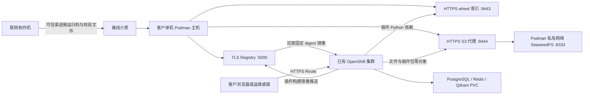

# Dify Enterprise 离线安装技术移交：客户手工手册编写与验证

本文交给 Dify 的交付、文档、研发和测试同事，用于理解本工程的离线方案，编写客户手工安装手册，并逐项验证。实现核对基线为 [47794b185146](https://github.com/SammZhu/dify-enterprise-openshift/tree/47794b1851461e2b2f4da875128592c3ff038982)，核对日期 2026-11-05；产品/Chart 升级后应重新审查。基线为本仓库当前原生 Ansible 客户实现；不是在线 GitOps 安装的步骤替换，也不要求客户部署 Git、ArgoCD 或预先拥有镜像仓库。

**交付状态必须区分：**客户自动制包、部署和修复后的验收已在 RHDP OpenShift 4.20.8 验证；本文的纯手工顺序尚未在全新环境逐条独立执行。当前介质没有预制的“客户手工安装包”：依赖清单、带真实凭证的 values 和离线派生 Chart 都在安装时动态生成，临时文件随后清理。因此本文是技术移交和手工手册的编写/测试基线，不能直接标成“已验证的客户手工安装手册”。第 6 节明确列出手工交付前须补齐的产物；本文不假定这些文件已经存在。

本文随完整源码供工程移交，不加入当前客户介质文档白名单，避免被当作可直接执行的正式手工交付包；客户包仍以 Quick Start 为入口。

自动化的主入口继续使用 Ansible。本文展示底层 CLI，是应手工手册需求解释操作，不增加第二套 Python/Shell 安装控制器。

## 1. 阅读路径与在线移交的区别

| 资料 | 用途与边界 |
|---|---|
| [客户 Quick Start](customer-quickstart.md) | 当前可执行的自动化操作主线，含路径、参数、制包、离线控制端、安装与代理访问 |
| [原生 Ansible 原理](native-ansible.md) | 阶段编排、绑定、租约、归属与重跑保护 |
| 本文 | 为什么需要各步骤；手工对应动作、文件契约、源码依据和手工验证关卡 |
| [高级配置](disconnected-manual.md) | 同一 Role 的外部 S3/ODF、arm64 参数分支，**不是手工安装步骤** |
| [验收清单](disconnected-validation.md)、[清理重装](disconnected-reset.md) | 部署与业务验收、数据删除范围和恢复责任 |
| [RHDP 记录](rhdp-dify-offline.md) | 现场证据及未覆盖范围；不能当作所有客户场景通过 |
| [在线环境移交](handover.md) | 历史在线 GitOps 环境、SSO、模型与观测集成；其中账号、有效期、端点和操作禁令不适用于本文离线 Helm 方案 |

在线移交要求通过 Git/ArgoCD 变更；离线方案由客户入口调用本地 oc/Helm，二者不能同时管理同一个 release。离线默认不安装 GitOps、ODF、Keycloak、日志/追踪平台或本地模型，也不继承在线环境账号和授权。

## 2. 架构、请求路径与责任



本次现场 16 个应用工作负载按下面分组盘点；这些是运行架构清单，不等于每个业务功能均已验证。最终命名/副本以本次 Chart 渲染和集群资源为准。

| 组件组 | 本次工作负载后缀 | 对手工交付的意义 |
|---|---|---|
| Web/企业前端与入口 | web、enterprise-frontend、gateway | 六个 Route 与实际 host/path、TLS、SSE、浏览器访问 |
| API 与后台任务 | api、worker、worker-beat、trigger-worker | 数据库、Redis、对象存储、模型/插件；Ready 不代替任务和触发器验收 |
| 企业服务 | enterprise、enterprise-audit、enterprise-collector | 企业配置/License、审计和产品采集；不等于已部署 OpenShift 日志/追踪平台 |
| 插件控制/运行链路 | plugin-connector、plugin-manager、plugin-daemon、crd-controller | CRD/RBAC、运行时镜像、构建/推送凭证、pip依赖与CA，不能只盘点现有Pod镜像 |
| 执行与访问隔离 | sandbox、ssrf-proxy | 专用SCC/能力、代理策略与业务连通性；不通过提高全局权限解决问题 |

单机 Podman 主机是离线基础服务，不是 OpenShift 节点。Registry 不使用 OpenShift 内置 Registry；插件构建镜像也写入这个外部本地 Registry。wheel 索引不负责模型下载；SeaweedFS 是默认单机实验对象存储，不提供生产 HA 承诺。离线应用使用六个 Route；Registry CA 与 Route CA 是两条独立信任链。

| 发起方 → 接收方 | 默认端口/协议 | 必须验证 |
|---|---|---|
| 制作机 → 源 Chart、镜像、工具、依赖源 | 通常 HTTPS 443 | 联网侧授权、可信来源及制品摘要 |
| 离线运维端 → OpenShift API | HTTPS 6443 | kubeconfig/context 明确，API 可达且证书有效 |
| 节点及 Pod → Podman 主机 | HTTPS 5000 | DNS、网络、Registry CA、拉取认证 |
| 插件构建 Pod → Podman 主机 | HTTPS 9443 | wheel 索引、构建镜像内 CA、匹配 ABI 的依赖 |
| Dify Pod → Podman 主机 | HTTPS 9444 | S3 认证、bucket、CA、读写删除 |
| nginx → SeaweedFS | 私有网络 HTTP 8333 | 仅 Podman 服务网；不发布 8333/Admin 端口 |
| 浏览器 → OpenShift Router | HTTPS 443 | 内网域名、路由、Route CA；RHDP 可经 Jump SOCKS5 |
| 集群内应用 → 数据层 | PostgreSQL 5432、Redis 6379、Qdrant 6333 | Service DNS、Secret、PVC 与 NetworkPolicy |

默认数据库和 Redis 的连接不启用 TLS，Qdrant endpoint 是集群内 HTTP。TLS Registry/S3 并不等于全链路加密；客户如有内部传输加密要求，须作为额外适配和验收项。

客户负责已有且健康的集群、DNS/防火墙、StorageClass、软件包来源、cluster-admin 授权、备份和源镜像/License 合法授权。Dify 团队负责产品参数、License、插件/模型依赖闭包及业务验证。本文不提供创建 OpenShift 或修改客户边界网络的隐含步骤。手工客户验证还应检查防火墙/DNS/代理日志中的非预期公网访问；关闭 Marketplace 与镜像全内网并不证明所有产品页面或业务功能都没有外部依赖。

## 3. 版本、容量与权限基线

| 项目 | 当前默认/证据 |
|---|---|
| Dify Enterprise / vendor Chart | 3.9.8 / `dify-enterprise` 3.9.8；本地文件 `dify-enterprise.tgz` |
| OpenShift | 参数支持 4.20.x、4.21.x；本次现场只验证 4.20.8 / amd64 |
| 主机 | RHEL 9 系、默认 Linux amd64；前置 Playbook 要求 RHEL 9.4+ 兼容系统 |
| 工具 | Helm 3.16.4；oc 按客户补丁版本下载；Podman 使用主机 RPM |
| 自动化控制端 | Python 3.12、ansible-core 2.20.10，完整固定依赖见包内 requirements.txt |
| 手工 CLI 端 | Podman、OpenSSL、httpd-tools、tar、oc、Helm；不运行 Ansible时不因本方案强制要求 Python。额外 JSON/YAML 工具如使用，须单独纳入 OS 离线介质 |
| 命名空间 / release / SA | `dify` / `dify` / `dify`，不是已验证的任意名称模板 |
| PVC | PostgreSQL 30 GiB、Redis 5 GiB、Qdrant 30 GiB；现场 gp3-csi，仅作为存储实现示例 |
| 磁盘 | 制作前至少 30 GiB 可用，建议 60 GiB；离线主机建议至少 60 GiB并按镜像/对象数据增长扩容，不把 7.3 GiB 压缩包大小当作运行容量 |
| 单节点实验 | 8 vCPU / 32 GiB 是演练参考，不是生产 sizing 或性能承诺 |

OS 软件须预先由客户安装介质/内网仓库提供，Dify 介质不包含 RPM。RHDP 的 RHUI 软件源例外不等于物理断网下安装 OS 依赖已验证。arm64、外部对象存储、HA 和全新客户环境仍需独立验证。

安装包含集群级写入：CRD、SCC/相应使用授权、`openshift-config` CA ConfigMap 和 `image.config.openshift.io/cluster`。不能写成“只要 namespace admin 即可安装”。运行时服务账号也不能因此获得 cluster-admin。

## 4. 参数来源与合并逻辑

制作侧参数在私有 `prepare.yml`；安装侧参数在私有 `install.yml`，均在源码和 Git 目录之外。客户路径使用自己有写权限的目录；不能把 RHDP 的 `/mnt/low-side-data`、`disco.lab` 或 AWS 存储类写成客户前提。

| 参数 | 填写方/来源 | 改动影响 |
|---|---|---|
| `customer_media_root` | 制作用户选定的新持久化目录 | 包的输出位置，失败后选新目录，不修补旧 bundle |
| `customer_source_authfile` | 镜像授权提供方交付的认证 JSON，或交互登录产生 | 仅联网拉取；`auths` 域名不是镜像清单，不随介质交付 |
| `customer_ocp_version` | `oc get clusterversion version` 的实际 desired.version | 匹配 oc 下载；4.20/4.21 支持范围仍按现场证据区分 |
| `customer_apps_domain` | `oc get ingress.config.openshift.io cluster` 的 spec.domain | 六个应用域名，属于制包配置 |
| `customer_registry_host` | 内网 DNS 管理员确认的 Podman 主机稳定 FQDN | 证书 SAN、节点/Pod 路径、Registry/wheel/S3 endpoint |
| `customer_storage_class` | 客户确认可用的 StorageClass | 三个数据层 PVC；不能自动假定 gp3-csi |
| `customer_bundle_dir` | 离线机本次已校验的 `bundle` 绝对路径 | 只读输入，不写客户凭证或更新代码进去 |
| `customer_state_root` | 离线机管理员选定的专用私有目录 | 证书、认证、数据、绑定、报告；不是包所在目录 |
| `customer_kubeconfig` / `customer_context` | 客户集群管理员提供并确认 | 明确目标集群；不是 prepare 参数 |
| `customer_tls_cert/key/ca` | 客户 PKI；三者一起提供，或全部留空 | Podman 三服务的 TLS；重跑不会隐式轮换 |
| `customer_route_ca` | 客户 Route PKI | 只用于 HTTPS Route 验收，不替代 Registry CA |

最终 `bundle/config.yaml` 合并顺序是：`examples/helm/values.yaml` → `values-disconnected.yaml` → 客户拓扑覆盖 → 可选 `customer_values_overlay`，后者优先。vendor 细项再通过 `offline.chartValues` 覆盖。

**不能只合并两份公共 values 就声称得到默认离线配置。** 公共 disconnected overlay 的 `objectStorage.enabled=true`、`localS3.enabled=false`、wheel 端口 8443 是扩展默认；客户 Role 随后将 objectStorage/minio 关闭、localS3 打开、wheel 端口设为 9443，并替换真实主机和存储类。手工交付必须以最终 `config.yaml` 为准。

## 5. 介质和私有状态的文件契约

```text
bundle/                         # 已封存输入
  config.yaml                   # 最终非明文凭证配置
  checksums.json                # 完整文件集合及 SHA256（不含自身）
  images.lock.yaml              # OCI 镜像身份、来源、归档和服务 roles
  plugins.lock.yaml             # 审核后的插件包身份
  dify-enterprise.tgz            # 原 vendor Chart
  customer-media.json           # 目标/控制端版本与平台记录
  images/000.tar ...            # 每个引用一个单平台 OCI archive
  bin/oc, bin/helm
  source/examples/helm/components/
  pypi/simple/                  # 插件依赖的静态 simple 索引，可合法为空
  plugins/                      # 可选 .difypkg
  controller-wheels/            # 运行 Ansible 的 wheels，不是插件依赖
  ansible/, docs/, README.md
```

制作机外层还有 `media-ready.json`、最终 tar.gz 和 `.sha256`。`images.lock.yaml` 的存在早于整个制包完成，不等于可交付；最终包和 readiness 结果完成后才能搬运。

| 私有运行文件（以 `customer_state_root` 为根） | 含义/处理 |
|---|---|
| `state/certificates/`、`state/tls/` | CA/叶子证书和私钥；私钥不能进入公开介质，续跑保持同一身份 |
| `state/auth.json`、`state/htpasswd`、`state/auth/htpasswd` | 目标 Registry 的 auth JSON/bcrypt；不同于联网源 authfile |
| `state/local-s3.json`、`state/local-s3.env` | SeaweedFS 认证及 bucket；与集群 `dify-local-s3` 必须一致 |
| `state/registry-data/`、`state/s3-data/` | Registry 和对象数据；持久化与备份对象 |
| `state/image-map.json`、`state/import.yaml` | 全部源引用 → 实际目标 manifest digest，以及 lock/CA 绑定 |
| `customer-binding.json`、`.ansible-run/` | 自动安装的集群/介质绑定和独占租约，不是手工模板 |
| `stages/`、`logs/`、`deployment-ready.json` | 历史阶段、私有诊断、部署验收结果；阶段标记不代替实时检查 |

包完整性不仅是外层 SHA：自动安装验证文件集合、每个文件 SHA、无链接/特殊文件、OCI manifest/config 摘要。`checksums.json` 是 JSON，不能直接用 `sha256sum -c checksums.json`；手工交付要提供经验证的对应校验办法，不能省略或让客户自行重写封存清单。

## 6. 手工交付的产物关卡（发布前必须完成）

**下表的手工产物目前不是 bundle 的既有文件。** Dify 团队须按第 7～10 节从同一版本源材料准备、审核和封存，给出真实文件名、输入方式和 SHA；客户手册不得引用虚构的 `manual/` 目录或已被自动安装清理的临时文件。

| 手工交付物 | 内容/来源 | 秘密与校验要求 |
|---|---|---|
| 手工参数表 | 第 4 节实际域名、版本、路径、SC、端口 | 参数来源、执行主机、用户和保存位置明确 |
| 软件/镜像 BOM | Chart、CLI、RPM 前提、29 引用只是本次实例、插件/模型清单 | 按本次 lock，记录源码提交、架构、摘要、授权，不用浮动 tag 当最终身份 |
| OCI/完整介质验证说明 | 对照 `verify.yml`、export-image.yml | 损坏/缺失/额外文件与错误架构都应阻止继续 |
| 服务配置模板 | nginx、systemd、TLS、auth、S3 文件格式 | 公开模板无凭证，客户私有文件 0600；不要误带实验账号 |
| 依赖资源 YAML | prereqs、plugin-crds、PostgreSQL、Redis、Qdrant，按组分文件 | 镜像已映射、Job/SA/RBAC 就绪顺序明确；不得依赖 ArgoCD sync-wave |
| vendor 离线 values 模板 | 第 9 节覆盖项，说明 Secret 值如何进入私有 values | 不把明文写回 ConfigMap/Git；从集群取值后仅在私有文件处理 |
| vendor 离线 Chart 或等价正式机制 | 第 10 节的资源转换、字面量配置、hooks、digest | 必须保留 Helm hooks；若用正式 Chart 原生支持替代，应重新验证等价行为 |
| 验收资源与记录表 | S3 探针 Job、Pod/镜像/DB/Redis/HTTPS 及业务检查 | pinned AWS CLI 镜像、临时对象/Job 清理；结果不含密钥 |
| 备份/重启/删除说明 | 第 12 节 | 数据损失、共享集群资源保留、恢复先后次序明确 |

推荐先使用同一受控介质对照自动流程产生的对象和本地真实 Chart 渲染，再在**空白验证目标**独立执行手工步骤。当前已部署的 RHDP 环境是参考证据，不能直接拿它做第二个安装器的接管试验；同名容器、namespace 或 Helm release 存在时应停下核对归属。

## 7. 手工阶段一：准备、搬运与离线基础服务

### 7.1 联网侧准备

自动实现对应 `prepare/preflight.yml`、`tools.yml`、`export.yml`、`export-image.yml`、`plugin-media.yml`、`controller.yml`、`package.yml`。

联网工作包括匹配版本的 oc/Helm（发布方 SHA 校验）、Chart 身份检查、最终配置、镜像静态和运行时引用收集、按平台拉取/OCI 导出、插件/依赖审核、完整校验和归档。Chart 当前从 `https://charts.openshift.io` 获取；离线侧不运行 Helm repo update、在线 helm pull/dependency update、podman pull 或公网 pip install。

不能只搜索 Deployment 的 `image:`：还必须收集 Job/initContainers、`plugin_connector` 的 shader/gateway/busyBox/awsCli、generatorConf 内各 Python 版本基础镜像，以及 Registry/nginx/SeaweedFS。可选插件轮子必须满足它们各自 Python ABI/平台；控制端 Python 3.12 wheels 不表示插件 Python 3.13/3.14 依赖已齐全。默认关闭 Marketplace；模型权重和 License 不随平台介质自动补齐。

如果 Dify 同事只需要验证“手工离线安装”，可先用受控 Ansible 制作同一镜像介质，手工执行离线侧步骤。该验证不等于“纯手工制包”已验证，手册必须说明制作侧的方式。

### 7.2 离线侧设置参数与校验

以下只读/准备命令在**离线 Podman 主机的 Bash、root shell**执行。路径通过交互填写实际值，避免把 Demo 路径当客户默认；安装手工目标不能与现有自动安装共用状态目录或未经审核接管同名资源。

```bash
umask 077
printf '本次已解包 bundle 的绝对路径：'
read -r DIFY_BUNDLE
printf '本次手工安装专用私有状态根目录：'
read -r DIFY_MANUAL_ROOT
printf '客户管理员提供的 kubeconfig 绝对路径：'
read -r KUBECONFIG
export KUBECONFIG
printf '客户确认的 context：'
read -r DIFY_CONTEXT
printf 'Podman 服务主机 FQDN，不带协议或端口：'
read -r DIFY_SERVICE_HOST
export PATH="$DIFY_BUNDLE/bin:$PATH"
oc --context "$DIFY_CONTEXT" get clusterversion version
oc --context "$DIFY_CONTEXT" get ingress.config.openshift.io cluster
oc --context "$DIFY_CONTEXT" get nodes
oc --context "$DIFY_CONTEXT" get storageclass
```

参数必须与最终 `config.yaml` 一致，不是让客户输入一个新域名覆盖原包。先在归档所在目录用同名 `.sha256` 校验，再解包并按第 5 节验证完整内容。命令失败、集群不健康、身份/域名/架构不符时停止。状态根目录必须专用、真实路径、无祖先 symlink/Git；不能只用 `mkdir` 代替这些检查。

### 7.3 TLS 和认证

单主机三个 HTTPS 服务共用叶子证书，SAN 必须包含 `DIFY_SERVICE_HOST`。参考实现自建 RSA 3072、365 天 CA 和叶子证书；客户可一次性提供叶子证书、私钥、CA 三件套。自建 CA 仅用于客户许可的场景；证书到期监控和轮换必须进客户运维计划。已有证书/认证不可在重跑时重新随机生成。

在私有状态的 `state/` 下准备 `certificates/server.crt`、`server.key`、`ca.crt`，并复制叶子证书/私钥到 `tls/`。验证例子（必须是此前已准备的文件）：

```bash
DIFY_STATE="$DIFY_MANUAL_ROOT/state"
openssl verify -CAfile "$DIFY_STATE/certificates/ca.crt" \
  -verify_hostname "$DIFY_SERVICE_HOST" "$DIFY_STATE/certificates/server.crt"
```

Registry 使用 bcrypt htpasswd；参考账号名 `offline`，新密码 64 个字母数字。根 `state/htpasswd` 与容器挂载 `state/auth/htpasswd` 一致；`state/auth.json` 的 `auths` 键必须是实际 `主机:5000`，auth 为 base64(username:password)，这是凭证而不是加密。采用交互输入/stdin或客户秘密管理流程，不在 argv、终端输出、命令历史或手册填真实密码。

S3 的 `local-s3.json` 包含 `bucket`、`accessKey`、`secretKey`；`local-s3.env` 是 `AWS_ACCESS_KEY_ID`、`AWS_SECRET_ACCESS_KEY`、`S3_BUCKET` 三行。私有文件 0600、父目录 0700；同一值稍后写入集群 Secret。密钥格式/生成方式由 Dify 手工交付说明确定，不把模板占位字符串用于实际运行。

### 7.4 启动单机 Podman 服务

自动依据 `images.lock.yaml` 中 roles=`registry`、`wheel-server`、`object-store` 找到归档并用 `podman --cgroup-manager=cgroupfs load -i` 加载。使用 `imageId` 启动；不能用源 tag 临时拉镜像，也不能假设第 000 张就是 Registry。

`sourceImageId` 是源镜像身份，`imageId` 是 OCI config 的实际可加载身份，两者可能不同；`sourceDigest` 指归档内选中的 OCI manifest，不是目标 Registry push 后的 digest。

手工对应的服务契约如下；Dify 团队应按它提供审核过的命令和 nginx 配置，而不是让客户猜挂载目录：

| 容器 | 创建参数和挂载契约 |
|---|---|
| `dify-offline-s3` | rootful、`--pull=never`、`--restart=unless-stopped`、网络 `dify-offline`、`--user 0`、env-file `state/local-s3.env`、`state/s3-data:/data:Z`、命令 `mini -dir=/data`；不加公网端口映射 |
| `dify-offline-registry` | rootful、禁止 pull、restart 同上、`5000:5000`；`state/registry-data:/var/lib/registry:Z`、`state/tls:/certs:ro,z`、`state/auth:/auth:ro,Z`；`REGISTRY_HTTP_TLS_CERTIFICATE=/certs/server.crt`、`REGISTRY_HTTP_TLS_KEY=/certs/server.key`、`REGISTRY_AUTH=htpasswd`、`REGISTRY_AUTH_HTPASSWD_REALM=offline`、`REGISTRY_AUTH_HTPASSWD_PATH=/auth/htpasswd` |
| `dify-offline-pypi` | rootful、禁止 pull、restart 同上、网络 `dify-offline`，发布 9443 和 9444；`bundle/pypi:/usr/share/nginx/html:ro,Z`、`state/tls:/certs:ro,z`、`state/nginx.conf:/etc/nginx/nginx.conf:ro,Z` |

三者标签为 `io.dify.offline.bundle=<images.lock.yaml 的 SHA256>`；它证明与哪份 lock 对应，不是产品版本标签。已存在容器须核对 ID、标签、实际挂载和启动历史，不能直接 `rm -f` 后重建；自动重建仅允许已证明归属且从未启动的部分服务。

nginx 的两个 server 分别在 9443 提供 `/simple/` 静态索引（autoindex off），在 9444 反向代理 `http://dify-offline-s3:8333`。S3 代理设置 `client_max_body_size 0`、保留 `$http_host`、关闭请求及响应 buffering；两者共用 `/certs/server.crt` 和 `/certs/server.key`。S3 认证由后端提供，wheel 索引本身无账号认证，因此只能放在客户允许访问的内网范围。`:z` 是共享 SELinux 标记，不能把共用 TLS 目录随意改成独占 `:Z`。

启动顺序为 S3 → Registry → nginx。校验必须保留 TLS 验证：Registry 认证 GET `/v2/` 为 200，wheel `/simple/` 为 200，匿名 S3 根路径为 403。403 在这里是匿名被拒绝，不是认证 S3 功能已通过；后面还要做读写删除测试。

手工启动 Registry 后，可通过 Podman 交互登录生成目标 authfile；应使用与 htpasswd 相同的账号密码和私有 CA，不能继续使用联网源 authfile。具体命令选项以手工交付验证的 Podman 版本为准。

## 8. 手工阶段二：镜像导入与三层 CA 信任

### 8.1 镜像映射算法

对 lock 中每个源引用，按 **lock 列表原始索引**映射为 `REGISTRY/dify-offline/image-NNN:bundle`。其中 NNN 是从 000 开始的三位索引，不根据人读的镜像名字排序重编号。

1. 校验 OCI archive 与 config/manifest，load 本地归档，使用 lock 的 `imageId`。
2. 若是 Kaniko executor 或 plugin-build-base-python，先离线派生 CA 镜像：下面的约束必须一起保留。
3. 向目标 Registry 使用私有 `auth.json` 和 `podman-certs/ca.crt` 进行 TLS 验证 push，以 `--digestfile` 保存目标摘要。
4. 记录 `source → REGISTRY/dify-offline/image-NNN@sha256:...`。所有镜像 push 成功之后才发布完整映射；不拿源 digest 替代实际 push digest。

用于解释“单张普通镜像 push”的命令如下；输入均取自已核对的 lock 和本次索引，不是固定样例镜像。该片段不替代完整导入记录、CA 派生和介质校验：

```bash
printf '本条 lock 记录的 OCI 归档绝对路径：'
read -r DIFY_IMAGE_ARCHIVE
printf '本条 lock 记录的 imageId（含 sha256:）：'
read -r DIFY_IMAGE_ID
printf '本条镜像的目标仓库（含主机:端口/dify-offline/image-NNN，不含tag）：'
read -r DIFY_IMAGE_REPOSITORY
podman --cgroup-manager=cgroupfs load -i "$DIFY_IMAGE_ARCHIVE"
podman --cgroup-manager=cgroupfs push \
  --authfile "$DIFY_STATE/auth.json" \
  --cert-dir "$DIFY_STATE/podman-certs" \
  --digestfile "$DIFY_STATE/push-digest" \
  "$DIFY_IMAGE_ID" "docker://$DIFY_IMAGE_REPOSITORY:bundle"
```

CA 派生构建必须 `--pull=never --network=none`，以已加载 ID 的本地 tag 为 FROM；不能暗中联网补层。Kaniko 加入 `/kaniko/ssl/certs/offline-registry.crt` 并设置 `SSL_CERT_DIR=/kaniko/ssl/certs`；Python 构建基础镜像加入 `/opt/offline-ca.crt`，设置 `SSL_CERT_FILE`、`REQUESTS_CA_BUNDLE`、`PIP_CERT` 指向该文件，及 `UV_NATIVE_TLS=true`。最终 push 的是派生 image ID，映射记录其新 digest。

### 8.2 三个不同层面的信任

| 信任层 | 解决的问题 | 不能替代 |
|---|---|---|
| Podman CLI 的 `state/podman-certs/ca.crt` | load/build 后向 Registry push、登录 | 节点 CRI-O 的拉取信任 |
| OpenShift image additionalTrustedCA | 节点拉取 Registry 镜像 | 应用访问 S3、构建进程访问 Registry/pip |
| `offline-registry-ca` + Dify customCA + CA 派生构建镜像 | 应用与动态插件构建过程使用私有 TLS 服务 | 浏览器访问 Route 的 router CA |

OpenShift 侧先读取 `image.config.openshift.io/cluster.spec.additionalTrustedCA.name`。若已引用某个 ConfigMap，**合并到该 ConfigMap而不替换其其他键**；若为空，才创建专用 `dify-offline-registry-cas`。数据键使用 `主机..5000`（端口分隔符 `:` 转成 `..`），值是 PEM CA。更新 image config 时检查原 resourceVersion，避免覆盖其他管理员的并发操作。依据见 [OpenShift 4.20 CA 配置](https://docs.redhat.com/en/documentation/openshift_container_platform/4.20/observability/builds_using_buildconfig/setting-up-trusted-ca)。

不要为了方便将 Registry 设置为 insecure、覆盖全局 pull secret 或清空既有 additionalTrustedCA。节点配置变更需观察 MachineConfigPool/节点及实际镜像拉取，不能把 ConfigMap 创建成功当作完成。

## 9. 手工阶段三：集群前置资源、数据库及 values

### 9.1 集群秘密与权限

创建 namespace `dify` 后，先准备以下身份；秘密只在客户私有文件/集群中处理，不提交 Git：

| Secret | 类型/键 | 来源和使用者 |
|---|---|---|
| `offline-registry-pull` | kubernetes.io/dockerconfigjson，`.dockerconfigjson` | 目标 Registry `state/auth.json`；全部工作负载拉取 |
| `image-repo-secret` | kubernetes.io/dockerconfigjson，`.dockerconfigjson` **和** `config.json` | 同一目标 auth JSON；Dify 插件构建推送固定名称 |
| `offline-registry-ca` | Opaque，`ca.crt` | Podman 服务 CA，供应用和探针挂载 |
| `dify-offline-keys` | `appSecretKey`、`innerApiKey`、`dashboardSecretKey` | 初次生成稳定随机值，自动实现为各 56 字母数字；重跑复用 |
| `dify-local-s3` | `accessKey`、`secretKey` | 与本地主机 S3 同一身份；不生成另一套值 |
| `dify-postgresql` | `database`、`username`、`password` | 生成凭证 Job；默认 dify/dify 与 values 一致 |
| `dify-redis` | `password` | 同一 Job |
| `dify-qdrant` | `apiKey` | 同一 Job |

手工可由客户秘密管理流程预置等价 Secret，或使用本地 prereqs Chart 中的 `dify-generate-secrets` Job；已有 Secret 不轮换。`image-repo-secret` 不能只创建 `.dockerconfigjson` 而省掉 `config.json`。Secret 中 data 是 base64，不是加密。

本地 prereqs Chart 负责 SA/RBAC、anyuid 基线和专用 SCC；sandbox 的 `dify-sandbox` 允许 SYS_CHROOT/所需提权但不允许 privileged 容器或 host access；`dify-nonroot` 优先级高于 anyuid，用于 plugin connector 等已列出的 SA。按实际渲染清单逐一交给客户平台管理员审核，不全 namespace 绑定 privileged。prereqs 的 privilegedForPluginBuild=false 不代表 vendor Chart 自己的 SCC/RoleBinding 已全部移除；最终权限必须对两个来源的渲染结果一起核对。插件 CRD 为 `difyplugins.enterprise.dify.ai`，需要 Established 后再部署控制器；不能只装命名空间 Role。

默认离线关闭 prereqs 的在线 imageBuilder/imageRepoSecret Job、RHDP 用户授权、观测集成等；Dify child 的 `chart.enabled=false`，防止渲染在线 ArgoCD Application。模板中的历史 ArgoCD 注解不能代替手工执行顺序。

### 9.2 依赖资源顺序

本地 Chart 位置是 `bundle/source/examples/helm/components/`，顺序为 `dify-prereqs` → `plugin-crds` → `postgresql` → `redis` → `qdrant`。默认不执行 objectstorage/minio/embedder。每组需完成 apply 和对应 readiness，才进入下一组：SA/RBAC 在生成凭证 Job 之前，Job 成功和数据库 Secret 在 StatefulSet 之前。

**values 形状是高风险点：**总配置是 `components.postgresql`，子 Chart 却读取顶层 `postgresql`。不能直接把 `bundle/config.yaml` 当子 Chart `-f` 使用。按 `render-child.yml` 把对应组件映射到顶层 key，加入 `namespace: dify`、`serviceAccountName: dify`。plugin-crds 输入是 `plugin_controller.installCrd: true`；Dify child 还需 deployer、空 litemaas 和 objectStorage 上下文。具体字段以子 Chart values 和模板为准。

当前 PostgreSQL init ConfigMap 的启动脚本显式确保 `dify`、`enterprise`、`audit`、`dify_plugin_daemon` 四个数据库存在。不要沿用 vendor values 模板中的历史注释，假定插件库会自动创建；以 `postgresql/templates/init-databases.yaml` 的实际实现为准。手工手册应等待 StatefulSet Ready 并确认四库，再启动应用；最终验收还需再次查询。

PostgreSQL `fsGroup=26`、Redis `fsGroup=1001` 是现有镜像/存储适配，不随意删除。PVC 的 WaitForFirstConsumer 可能在 Pod 调度后才 Bound，容量/SC/权限和实际数据写入都需检查。

### 9.3 vendor values 必须具备的离线配置

先用本地 Helm 查看 Chart defaults，并参考 `components/dify/templates/_values.tpl` 的基础应用配置，再叠加下表。**该模板本身不是最终离线 values**，直接使用会保留内置 Registry/默认存储等在线假设。

| 字段 | 本方案要求 |
|---|---|
| `global.openshift.enabled/routes.enabled` | true；六个 Route，edge TLS，HTTP redirect；Ingress 关闭 |
| `global.*Domain` | Console/API/App/Upload/Enterprise/Trigger 真实主机名；保持主机名及 HTTPS，不写 Jump IP |
| Route annotations | timeout 600s 用于长请求/SSE；forwarded headers append，仍需单独业务测试流式响应 |
| `externalDatabase` | PostgreSQL Service、5432、四个库名、dify 用户及对应 Secret 密码 |
| `externalRedis` | Redis Service、6379、对应 Secret 密码 |
| `vectorDB.externalQdrant` | **嵌套在 vectorDB 下**，Service HTTP endpoint 和 API key；不是顶层 externalQdrant |
| `persistence.s3` | endpoint `https://Podman主机:9444`、bucket dify、region us-east-1、addressType 空、useAwsManagedIam/useAwsS3=false，使用 dify-local-s3 身份 |
| `global.marketplace.enabled` | false；不能通过 overlay 悄悄重新打开 |
| `global.customCA` | enabled=true、existingSecret=offline-registry-ca |
| `global.appSecretKey/innerApiKey`、`enterprise.appSecretKey` | 分别取 dify-offline-keys 的 appSecretKey/innerApiKey/dashboardSecretKey |
| `imagePullSecrets` | 包含 offline-registry-pull；最终各类 Pod spec/SA 仍需独立检查 |
| `plugin_connector` | imageRepoPrefix=`Registry/plugins`、imageRepoType=docker、imageRepoSecret=image-repo-secret、insecureImageRepo=false |
| `plugin_connector.generatorConf` | Python pipMirror 为本地 HTTPS `/simple/`；所有 Python build-base 引用映射为目标 digest |
| shaderImage/gatewayImage/busyBoxImage/awsCliImage | 从真实 defaults 得到源引用，再用完整 image-map 映射；在 Helm 渲染/Secret checksum 计算前处理 |

`@@secret:name/key@@` 是本工程占位协议，不是 Helm 或 Dify 会自动识别的语法。自动入口从 `dify` namespace 读取、base64 解码，并按 JSON 字符串规则转义后放入私有 values；不把密码拼进 shell 或无转义的 sed。手工交付必须提供等价的秘密取值/转义流程，并验证 `@@secret:` 已全部消失。生成文件 0600，保留/清理和审计按照客户策略。

## 10. 手工阶段四：资源转换、Helm 安装与 hooks

当前实现不是把 vendor Chart 解包后直接 `oc apply`：它渲染本地 Chart、转换资源，再构造临时派生 Chart，由 Helm 执行安装及 hooks，结束后清理私有工作区。

手工方式必须实现同一结果，或由 Dify 团队在正式 Chart 中提供并验证等价原生能力：

1. **镜像替换匹配完整引用。** 最终 Deployment/StatefulSet/Job/initContainer、ConfigMap 文本和运行时配置全部使用目标内网 digest；不能把 `busybox:latest` 当子串替换，误改 `registry/other/busybox:latest`。
2. **Secret 中的文本也要转换。** 解码插件生成器等文本字段、替换、原样保留必要换行，再 base64；二进制字段保持不变。只扫描 YAML `image:` 会漏掉运行时创建的 Pod。
3. **先改运行时 values，再让 Helm计算 Secret checksum。** 只在渲染后改 Secret 内容会造成 annotation/checksum 不一致。
4. **补齐拉取 Secret。** Pod/SA、Deployment/StatefulSet/DaemonSet/ReplicaSet/Job 的 template 和 CronJob 的 jobTemplate 都需覆盖，不能只改顶层 Deployment。
5. **保留 OTLP 修正。** `dify-dify-enterprise-plugin-daemon-config` 中 OTLP_* endpoint 末尾 `-collector-svc:4317` 调整为 `:4318`；这是已审查的服务行为适配，不是将所有组件 gRPC 端口一律改成 HTTP。
6. **保留字面量与 hooks。** 渲染后的 ConfigMap 内可能有 `{{ ... }}` 文本，不能当模板再执行；hook annotations、权重和删除策略应保持。当前通过每个资源 base64 的 Helm 字面量模板实现，不使用 Python post-renderer。

[Helm hooks](https://helm.sh/docs/topics/charts_hooks/) 的生命周期不能由对渲染结果一次 `oc apply -f` 替代。依赖组资源由 oc 管理，vendor 资源由 Helm release 管理，也不能说所有资源都属于 Helm。

自动入口先证明没有无关同名 release，再设置 `dify-offline-install` 所有者 ConfigMap，最后执行本地派生 Chart 的 `helm upgrade --install dify ... --kubeconfig ... --kube-context ... -n dify --force --wait --timeout 15m`。其中 `--force` 有重建资源含义，手工手册不能把该选项当作对任何已有 release 的通用修复；须说明初装/重装/升级及接管策略。不得对在线 ArgoCD 管理的 release 使用这条链路。

**手工交付阻断项：**当前包没有可直接引用的最终派生 Chart、依赖 YAML 或完整离线 values；它们在运行中才生成/包含秘密。Dify 同事应先制作第 6 节的正式手工材料，验证上述转换后再写最终 copy/paste 命令。不能在手册凭空写 `helm install dify bundle/manual-chart`，也不能复制一份临时 Chart 后去掉校验称为等价。若产品 Chart 能直接支持全部离线参数，应以该正式版本重新渲染、核对资源与运行时镜像并完成业务验证。

## 11. 手工阶段五：验收、浏览器及故障定位

### 11.1 部署验收顺序与只读命令

以下仍在离线主机 root Bash 中使用第 7.2 节设置的 kubeconfig/context；不打印凭证。

```bash
oc --context "$DIFY_CONTEXT" get pods -n dify
oc --context "$DIFY_CONTEXT" get pvc -n dify
oc --context "$DIFY_CONTEXT" wait pods -n dify \
  --field-selector=status.phase!=Succeeded,status.phase!=Failed \
  --for=condition=Ready --timeout=600s
oc --context "$DIFY_CONTEXT" exec dify-postgresql-0 -n dify -- bash -ec \
  'PGPASSWORD="$POSTGRESQL_PASSWORD" psql -h 127.0.0.1 -U "$POSTGRESQL_USER" -d postgres -Atc "SELECT datname FROM pg_database"'
oc --context "$DIFY_CONTEXT" exec dify-redis-0 -n dify -- sh -ec \
  'redis-cli -a "$REDIS_PASSWORD" --no-auth-warning ping'
oc --context "$DIFY_CONTEXT" get routes -n dify
```

等待命令过滤 Completed/Failed Job 只是避免把已结束 Job 当作 Ready Pod；最终还必须独立拒绝 Failed/Terminating/unready 工作负载，检查所有 Pod 的主/初始化容器引用都为目标 Registry digest。核对 `dify`、`enterprise`、`audit`、`dify_plugin_daemon` 四个库及 Redis PONG；只看到 Pod Running 不算应用验收。

S3 验收必须从**集群内**创建临时 Job，使用已映射的 AWS CLI digest、ServiceAccount dify、offline-registry-pull、offline-registry-ca 和 dify-local-s3；用 Pod UID 唯一对象名，执行认证 head-bucket/put/get/内容及长度比对/delete。限时 180 秒、成功或失败都清理自己的对象/Job/Pod，删除 Job 使用 UID 前提。不向客户手册写共享固定测试对象名，也不把 Podman 主机 curl 当作 Pod 网络读写证据。可据 `install/check-s3.yml` 制作第 6 节手工探针，缺少 cmp 时仍需内容与长度双重检查。

HTTPS 使用主机系统 CA、router CA及客户补充 Route CA 验证，不用 `-k`；至少一个 200 且各入口无 5xx。当前现场 App、Console 的 `/apps`、Enterprise/Upload/API 根路径为 200，Trigger 根路径 404；后者不证明触发功能已验证。浏览器如何经内网/Jump访问、Chrome 启动和证书信任，完整步骤见 [Quick Start 第 5.2 节](customer-quickstart.md#52-从浏览器访问离线-dify-console)。

### 11.2 常见问题与操作顺序

| 现象 | 先查哪里；不要怎样修 |
|---|---|
| API i/o timeout | 集群/节点是否启动、DNS、NLB/路由；RHDP 曾是 SNO EC2 stopped，不要先改 kubeconfig 或重新安装 |
| ImagePullBackOff / x509 / unauthorized | 精确镜像引用、节点 CA、SA/template 拉取 Secret、Registry 网络/认证；不关闭 TLS |
| Pod 启动但插件构建联网或失败 | generatorConf、编码 Secret、所有 build-base/辅助镜像、本地 wheels ABI/依赖闭包与构建 CA |
| PostgreSQL验收报 extra command-line argument | 使用上面的单一 SQL 参数；旧自动包曾保留反斜杠引号，修复是验收代码，不是重建数据库 |
| Secret/密码不一致 | 对照 retained state、集群 Secret 和实际服务；不轮换一半、不重跑随机生成覆盖已有值 |
| PVC Pending/容器不可写 | SC、WFFC、调度/容量、fsGroup/SCC；不为解决权限直接给 privileged |
| Pod 全 Ready 但功能失败 | 存储 endpoint、vectorDB 嵌套、License、provider、插件/runtime，继续业务验收 |
| 本机 ERR_INTERNET_DISCONNECTED | 先检查同一 SOCKS curl；使用已验证 Chrome 简化参数及新实验目录，不直接重装 Dify |
| 旧包文档或任务未更新 | GitHub 合并不会修改已封存包；参考 Quick Start 修复源码复验，不修改 bundle/checksums |

### 11.3 平台与业务必须分开签字

`deployment-ready.json` 由自动验收写入，权限 0600，scope 是 deployment acceptance only；手工操作不应伪造同名标记冒充 Role 已运行。手工验证另存自己的日期、执行人、客户/集群身份、包/Chart/lock摘要、步骤结果、资源清单与脱敏证据，按 [验收清单](disconnected-validation.md)逐项签字。

另验：离线 License 的合法取得/激活/续期；登录与初始化；文件上传/下载；模型提供方；`.difypkg` 导入、离线构建和调用；embedding 维度与实际索引/检索；RAG 引用；触发器；公网请求依赖和观测。在线演示的 SSO/模型/日志/追踪成果不能填入本次离线验收结果。

## 12. 运维、备份、重跑与清理

本机服务需要专用 systemd 单元 `dify-offline-services.service`：依赖 network-online 和介质/状态挂载，检查 lock/auth 存在，按 S3→Registry→nginx 启动，按相反顺序停止；`Type=oneshot`、RemainAfterExit、UMask 0077、超时与失败重试。参考 [单元模板](../ansible/templates/dify-offline-services.service.j2)，手工版本须填实际路径并通过 `systemd-analyze verify`，不让客户原样安装带 Jinja 变量的模板，也不伪称由 Ansible 管理。

`podman --restart=unless-stopped` 不能替代本工程的挂载依赖/启动顺序设计。主机重启后先确认数据盘、服务和 TLS，再检查节点拉取、Pod、数据库、S3和Route；不要直接声明“重启后自动恢复已通过”，当前原生重启全流程尚无新现场记录。

备份至少覆盖：数据库/PVC、S3数据（含租户相关私钥/文件）、Registry数据或可重导入介质、所有稳定应用密钥、Registry/S3凭证、服务CA/私钥、配置/映射/版本/归属记录。数据库与对象数据应有一致性策略，保留恢复演练证据。只备份 Helm values 或只保存镜像无法恢复业务。

当前自动清理 application 会删除 namespace/PVC/业务数据并清本地S3，full 进一步删除三个容器、单元和Registry数据；保留CA/凭证、介质、共享集群资源和镜像缓存。它有完整归属/PV回收策略/目录挂载/UID计划确认保护，不能压缩成无条件 `oc delete project dify` 和 `rm -rf`。

手工安装没有自动生成的完整 binding/lease/归属状态，因此不能假定能直接使用自动 reset 接管清理。手工删除也必须先盘点 Chart/UID/ownerReferences、Endpoints/Lease、PVC/PV reclaimPolicy、宿主挂载共享情况并确认数据损失范围；共享 CRD/SCC/CA ConfigMap 不默认删除，不强制移除 namespace finalizer。删除/恢复步骤须独立评审并演练。

## 13. 源码对照索引

以仓库当前提交为阅读基线；实际交付时记录完整提交 SHA，不把会变化的 main 当作永久证据。

| 主题 | 可直接审阅的实现 |
|---|---|
| 参数/合并/平台/配置边界 | [customer-defaults.yml](../ansible/customer-defaults.yml)、[prepare/preflight.yml](../ansible/roles/dify_offline/tasks/prepare/preflight.yml)、[validate-config.yml](../ansible/roles/dify_offline/tasks/validate-config.yml) |
| 源授权/工具/镜像/插件/封包 | [prepare/](../ansible/roles/dify_offline/tasks/prepare/)、[verify.yml](../ansible/roles/dify_offline/tasks/verify.yml) |
| 身份/服务/单元 | [service-identity.yml](../ansible/roles/dify_offline/tasks/install/service-identity.yml)、[service-create.yml](../ansible/roles/dify_offline/tasks/install/service-create.yml)、[service-autostart.yml](../ansible/roles/dify_offline/tasks/install/service-autostart.yml) |
| load/CA派生/push | [import.yml](../ansible/roles/dify_offline/tasks/install/import.yml)、[import-image.yml](../ansible/roles/dify_offline/tasks/install/import-image.yml) |
| 集群信任和稳定 Secret | [cluster-identity.yml](../ansible/roles/dify_offline/tasks/install/cluster-identity.yml)、[stable-secret.yml](../ansible/roles/dify_offline/tasks/install/stable-secret.yml) |
| 子 Chart 与默认 values | [render.yml](../ansible/roles/dify_offline/tasks/render.yml)、[render-child.yml](../ansible/roles/dify_offline/tasks/render-child.yml)、[components/](../examples/helm/components/) |
| 资源/编码内容/运行时镜像 | [transform-resource.yml](../ansible/roles/dify_offline/tasks/transform-resource.yml)、[map-text.yml](../ansible/roles/dify_offline/tasks/map-text.yml)、[resolve-values.yml](../ansible/roles/dify_offline/tasks/install/resolve-values.yml) |
| vendor Chart/hooks | [vendor-chart.yml](../ansible/roles/dify_offline/tasks/install/vendor-chart.yml)、[vendor-resource.yml](../ansible/roles/dify_offline/tasks/install/vendor-resource.yml) |
| 部署验收 | [check.yml](../ansible/roles/dify_offline/tasks/install/check.yml)、[check-s3.yml](../ansible/roles/dify_offline/tasks/install/check-s3.yml) |
| 删除与重跑安全 | [reset/](../ansible/roles/dify_offline/tasks/reset/)、[bind.yml](../ansible/roles/dify_offline/tasks/bind.yml)、[paths.yml](../ansible/roles/dify_offline/tasks/paths.yml) |

离线介质只带白名单内容，可能不含完整测试和 examples 的原位置；源码索引用于工程阅读，不是让客户在 bundle 内直接点击每个相对路径执行命令。手工资料封装时须同步文件位置和链接。

## 14. Dify 团队接收后应完成的工作

| 接收方 | 发布手工手册前的完成条件 |
|---|---|
| Dify 研发/Chart 维护者 | 确认全部离线 values、Secret 接口、动态镜像、CA、hooks 和权限；决定用正式 Chart 原生能力还是审核后的离线派生 Chart，不省略转换 |
| 介质/交付负责人 | 第 6 节手工产物齐全、版本/摘要/授权明确，无真实客户凭证；RPM、插件、模型、License 分开交付且来源清楚 |
| 文档负责人 | 每条命令标主机/用户/目录/输入来源/预期结果/失败停止点；客户拓扑是正文、RHDP 是附录；无不存在目录或可误复制的占位命令 |
| 平台/安全负责人 | 审核 SCC/RBAC、节点CA合并、端口、镜像授权和Secret暴露；vendor可能把凭证组合进ConfigMap，不能仅因使用Secret就声称秘密从不进入ConfigMap |
| 测试负责人 | 全新目标从手工介质独立执行，不借助原已安装服务；验证失败恢复、并发/接管拒绝、重启、备份恢复和清理；保留完整过程和脱敏证据 |
| Dify 产品/业务负责人 | 明确无 License 时行为，确认离线License、插件导入/构建、模型、上传/RAG/触发器等实际操作步骤 |

当前证据：原生制包成功；29 镜像导入和16应用+3数据层Pod就绪；验收曾在PG SQL引号失败，修复源码定向复验 `ok=165 failed=0`；集群内认证TLS S3与HTTPS通过；用户确认Chrome页面加载。**这不是纯手工安装、修复版新介质一次全程通过、原生清理重装/重启、4.21/arm64/外部存储/HA或业务验收的证明。** 具体经过以 [现场记录](rhdp-dify-offline.md#2026-11-05客户原生入口现场验证) 为准。

建议 Dify 同事交回三项成果：有版本号的客户手工手册、配套且可校验的手工交付材料，以及在全新环境按手册独立执行的验证报告。三者对应后，再把本移交稿中的“待补齐/待验证”改为正式支持声明。
